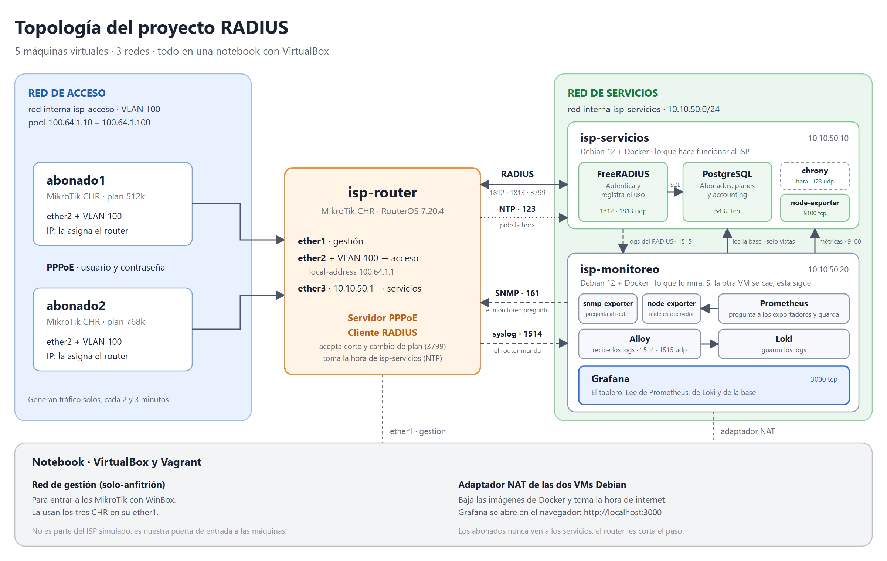

# Qué trae la rama `integracion-nacho`

Rama armada por Nacho el jue 19-nov. Parte de `parte5-grafana` (el commit de Igna) y **no está en `main`**: es una propuesta para revisar entre todos.

Toca la parte de cada uno. La sección 3 dice qué cambió en cada carpeta: **cada responsable revise la suya** y diga si está de acuerdo, antes de pasar nada a `main`.

> Lo armé con ayuda de Claude Code (la consigna permite usar IA). Todo se probó en VMs reales, en mi PC. Los errores que fueron apareciendo, y cómo se diagnosticaron, están en [`notas/nacho.md`](notas/nacho.md) y en el README de cada carpeta.

---

## 1. En corto

- **El proyecto anda de punta a punta:** los dos abonados entran por PPPoE, el router le pregunta al RADIUS, la base guarda el accounting cada minuto y el tablero muestra router, abonados, rechazos y logs.
- **Cuatro cambios grandes respecto del plan:**
  1. **Dos VMs Debian en vez de una.** El monitoreo va en su propia VM, `isp-monitoreo`, separado del servidor del ISP. Es lo que nos marcó el profesor.
  2. **Los servidores se crean con Vagrant** (`vagrant up`), no clonando y configurando a mano.
  3. **Las métricas siguen el modelo de Prometheus:** Prometheus les pregunta a exportadores. Alloy queda solo para los logs.
  4. **Velocidades 512k/512k y 768k/768k**, las que midió Rodri.
- **Para entender todo:** [`arquitectura.md`](arquitectura.md). Los resultados de las pruebas están en [`abonados/pruebas.md`](abonados/pruebas.md).

| | Plan inicial | Esta rama |
| --- | --- | --- |
| VMs | 4 | 5 |
| Contenedores | 6, en una VM | 9: 3 en `isp-servicios` y 6 en `isp-monitoreo` |
| Cómo se arman los servidores | A mano | `vagrant up` |
| Paneles del tablero | El mínimo más 3 o 4 | 24 |



---

## 2. Cómo probarlo

**Hace falta:** VirtualBox 7, Vagrant 2.4 e internet la primera vez (baja la imagen de Debian y las de Docker).

1. **Traer la rama:**
   ```bash
   git fetch
   git switch integracion-nacho
   ```
2. **Los dos servidores**, parados en la carpeta del repo: `vagrant up`. La primera vez tarda unos 6 minutos, más la descarga de la imagen de Debian. Si en VirtualBox ya tenés una VM llamada `isp-servicios` armada a mano, renombrala o borrala antes: Vagrant usa ese nombre.
3. **El router:** [`mikrotik/README.md`](mikrotik/README.md). Se importan tres archivos, uno por etapa: PPPoE, RADIUS y monitoreo.
4. **Los abonados:** los `.rsc` de Rodri, más [`abonados/trafico.rsc`](abonados/trafico.rsc) en los dos y [`abonados/moroso.rsc`](abonados/moroso.rsc) en abonado1 ([`abonados/README.md`](abonados/README.md)).
5. **Mirarlo:** Grafana en <http://localhost:3000>, usuario `admin`, clave `LabGrafanaAdmin-2026`, carpeta ISP.
6. **Operarlo:** `vagrant ssh isp-servicios` y después `sudo isp estado`. También `sudo isp suspender abonado2`, `sudo isp rehabilitar abonado2` y `sudo isp plan abonado1 plan-768k`.

**Prender y apagar:** se prende de adentro hacia afuera (servidores, router, abonados) y se apaga al revés. Los servidores con `vagrant up` y `vagrant halt`; las MikroTik desde VirtualBox, con "Apagado ACPI". En VirtualBox no uses "Iniciar" sobre el grupo entero si ahí tenés la CHR limpia que usás para clonar.

---

## 3. Qué cambió en cada parte

### Parte 1 · Base de datos (Agus) — [`postgres/`](postgres/)

| Qué | Dónde |
| --- | --- |
| Planes a 512k/512k y 768k/768k | `init/02-datos-acordados.sql` |
| Tres usuarios: el administrador, `radius` (FreeRADIUS lee y escribe solo lo que necesita) y `grafana_ro` (Grafana lee solo cuatro vistas). Reemplaza a `03-seguridad-grafana.sh` | `init/04-roles-y-permisos.sh` |
| Historial del accounting (un disparador copia cada aviso) y cuatro vistas para el tablero: `v_abonados`, `v_sesiones`, `v_trafico` y `v_logins` | `init/03-historial-y-vistas.sql` |
| Quién puede entrar a la base y desde dónde. La base ahora publica su puerto en la red de servicios, porque Grafana está en otra VM | `pg_hba.conf` |
| Los datos de prueba inventados ya no se cargan solos: se cargan a mano si hacen falta | `extras/datos-prueba-sinteticos.sql` |
| README de la parte, nuevo | `README.md` |

`init/01-schema.sql` no se tocó.

### Parte 2 · FreeRADIUS (Nico) — [`freeradius/`](freeradius/)

La parte está armada entera. **Nico: revisala y apropiatela**, porque la tenés que poder explicar.

| Qué | Dónde |
| --- | --- |
| Imagen propia: la oficial 3.2.10 más seis cambios, cada uno explicado en el archivo | `Dockerfile` |
| Solo el router puede consultar al RADIUS; el secreto entra por variable de entorno | `clients.conf` |
| Lee abonados y planes de PostgreSQL y guarda ahí el accounting | `sql` |
| Moroso rechazado con el grupo `morosos` (`Auth-Type := Reject`) | Datos de la parte 1 |
| Cortar a un abonado en el momento (Disconnect) y cambiarle el plan sin cortarlo (CoA) | Comando `servidor/isp` |
| Docker sabe si está vivo preguntándole en RADIUS (Status-Server), y sus logs llegan al tablero | `docker-compose.yml` |

### Parte 3 · Router (Nacho) — [`mikrotik/`](mikrotik/)

Tres archivos, uno por etapa: `01-base-pppoe.rsc` (VLAN 100, pool, perfiles, servidor PPPoE, usuario `btest`, protección), `02-radius.rsc` (cliente RADIUS, accounting cada minuto, acepta corte y cambio de plan) y `03-monitoreo.rsc` (SNMP de solo lectura y syslog hacia `isp-monitoreo`). En `export/` está lo que quedó en el router real.

### Parte 4 · Abonados y pruebas (Rodri) — [`abonados/`](abonados/)

| Qué | Dónde |
| --- | --- |
| `abonado1.rsc` y `abonado2.rsc` sin tocar | — |
| Tráfico automático cada 2 y 3 minutos, para que el tablero tenga movimiento. Usa el usuario `btest` del router (clave `BtestIsp2026`), así los abonados no guardan la clave de `admin` | `trafico.rsc` |
| Cliente PPPoE `moroso`, apagado, en abonado1: se prende para mostrar el rechazo sin tocar la conexión normal | `moroso.rsc` |
| Resultados de las pruebas de falla con el sistema completo | `pruebas.md` |

### Parte 5 · Grafana (Igna) — [`grafana/`](grafana/), [`alloy/`](alloy/), [`prometheus/`](prometheus/)

| Qué | Dónde |
| --- | --- |
| El monitoreo va en su propia VM, con su propio compose | `docker-compose.monitoreo.yml` |
| Métricas: Prometheus les pregunta a `snmp-exporter` (el router) y a un `node-exporter` en cada servidor | `prometheus/prometheus.yml` |
| Alloy solo recibe logs: los del router (1514/udp) y los de FreeRADIUS (1515/udp) | `alloy/config.alloy` |
| La comunidad SNMP pasó de `alloy/` a `prometheus/`, porque ahora la usa `snmp-exporter` | `prometheus/snmp-auths.yml` |
| La fuente de datos de PostgreSQL apunta a la otra VM (10.10.50.10) | `grafana/provisioning/datasources/` |
| Tablero de 24 paneles en 6 filas, cada uno con su frase de "para qué le sirve al ISP" | `grafana/dashboards/isp-noc.json` |

### De todos

| Qué | Dónde |
| --- | --- |
| Las dos VMs Debian | [`Vagrantfile`](Vagrantfile) |
| Preparar cada VM (hora, Docker), desplegar y el comando de operación `isp` | [`servidor/`](servidor/) |
| Los contenedores de `isp-servicios` | [`docker-compose.yml`](docker-compose.yml) |
| Claves de laboratorio. Cada VM recibe solo las que usa | [`.env.example`](.env.example) |
| Documentación general y topología | `README.md`, `plan-de-trabajo.md`, `arquitectura.md`, `topologia.svg`, `topologia.png` |

---

## 4. Decisiones para charlar

Son las que cambian lo que habíamos acordado. El detalle, con las alternativas descartadas, está en las secciones 5 y 13 de [`arquitectura.md`](arquitectura.md).

| Decisión | Qué decía el plan | Qué propone esta rama | Por qué |
| --- | --- | --- | --- |
| Dónde va Grafana | En `isp-servicios`, con el RADIUS | En `isp-monitoreo` | El que vigila no puede caerse junto con lo vigilado. Probado: con `isp-servicios` apagada, el tablero siguió mostrando el router y los logs |
| Cómo se crean los servidores | Clonar y configurar a mano | Vagrant | Se rearma igual en cualquier PC, con un comando |
| Quién junta las métricas | Telegraf (guía), después Alloy (Igna) | Prometheus pregunta a exportadores | Es el modelo de fábrica de Prometheus. Cada pieza hace una sola cosa, y la métrica `up` dice qué equipo dejó de contestar |
| Velocidades | 256k/512k y 512k/768k | 512k/512k y 768k/768k | Las que midió Rodri. La CHR sin licencia no pasa de 1 Mbps |
| VLAN por plan o para suspendidos | — | No: una sola VLAN, y el plan y el estado los decide el RADIUS | La VLAN dice por dónde llega el abonado; el plan es un dato de la persona. Cambiar de plan obligaría a tocar el equipo del abonado |
| Qué ve el abonado suspendido | Rechazo | Rechazo. La "zona restringida" (conecta pero solo ve un aviso) queda explicada, sin implementar | Alcanza para el proyecto y se explica en una frase |
| Una VM cliente para ver Grafana | — | No: el cliente es la notebook | La consigna pide verlo "funcionando en su máquina" |

---

## 5. Qué se probó y qué no

**Probado el 19-nov, en la PC de Nacho** (detalle en [`abonados/pruebas.md`](abonados/pruebas.md)):

- Las tres etapas del router, importadas sobre un router vuelto a fábrica.
- Abonados con usuarios locales y después por RADIUS, con la cola de cada plan. Bajada medida: 499 y 748 kbps.
- Moroso rechazado; suspender, rehabilitar y cambiar de plan sin cortar la conexión.
- Fallas: RADIUS caído, base caída, secreto distinto, clave incorrecta, reinicio del router, reinicio de las VMs y `isp-servicios` apagada entera.
- Borrar las dos VMs y recrearlas desde el repo: unos 6 minutos.
- Permisos: `grafana_ro` no puede leer las tablas, `radius` no puede borrar, y el administrador no entra por la red.

**No probado:**

- Nada se repitió fuera de la PC de Nacho.
- Que FreeRADIUS arranque con `isp-monitoreo` apagada. Debería: manda sus logs por UDP y no espera respuesta.
- El panel "Equipos", visto en el navegador. La consulta responde y Grafana lo carga.
- El apagado completo de `isp-servicios` con el diseño de exportadores (sí con el anterior).
- "Contraseña incorrecta" y "cambio de plan" con usuarios locales. Las dos se probaron con RADIUS.

---

## 6. Pendientes

- [ ] Ponerle clave a `admin` en las tres VMs MikroTik. Hoy está sin clave.
- [ ] Notas: `notas/agustin.md` y `notas/igna.md` describen el diseño anterior; `notas/nico.md` está en blanco; `notas/nacho.md` tiene partes entre corchetes para completar.
- [ ] Decidir en qué PC se presenta (sigue abierto en el plan).
- [ ] Decidir entre todos si esto pasa a `main`, y qué se cambia antes.

Un detalle conocido: al prender `isp-servicios`, FreeRADIUS arranca una vez de más. Docker lo levanta antes de que la base acepte conexiones, falla y Docker lo vuelve a levantar un segundo después. Se cura solo.

---

## 7. Los commits

Están separados por parte, para que cada uno vea solo lo suyo:

```bash
git log --oneline main..integracion-nacho
git show <commit>          # el detalle de uno
```

| Commit | Parte |
| --- | --- |
| Parte 1 (base): planes, tres usuarios, historial, vistas y acceso por red | Agus |
| Parte 2 (FreeRADIUS): imagen propia conectada a PostgreSQL | Nico |
| Parte 3 (router): configuración por etapas | Nacho |
| Parte 4 (abonados): tráfico automático, cliente moroso y pruebas | Rodri |
| Parte 5 (monitoreo): VM propia, Prometheus con exportadores y tablero | Igna |
| Servidores: dos VMs Debian con Vagrant y comando de operación | Todos |
| Documentación: arquitectura, topología, plan y esta guía | Todos |
