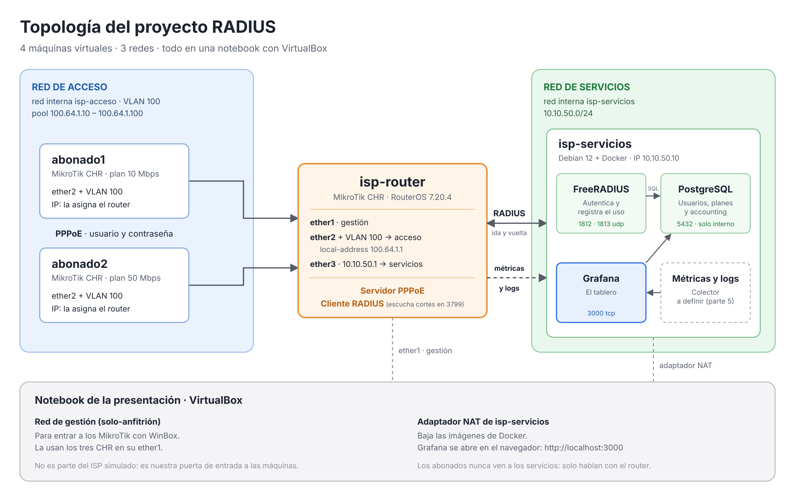

# Proyecto final RADIUS — Plan de trabajo del grupo

Administración de Servicios en Linux · UTN FRM · Versión unificada del 19 de noviembre · Presentación: jueves 26 de noviembre

> Este es el **único documento de trabajo** del grupo. Junta la consigna, los acuerdos de la reunión, la topología y la división del trabajo. Reemplaza al Word del 18-nov y a la versión anterior de este archivo. Si alguien cambia un dato común, avisa al grupo y lo actualiza acá.

## 1. Qué pide el proyecto

Tenemos que simular el problema de un ISP (una empresa que vende internet):

- Sumarle al router MikroTik un **servidor RADIUS**.
- Simular **abonados** que se conectan por **PPPoE** y generan tráfico.
- Mostrar en **Grafana** cómo está el router y qué hacen los abonados.

Todo tiene que funcionar en **una sola computadora** el día de la presentación.

| Pieza | Qué se espera |
| --- | --- |
| FreeRADIUS (en Docker) | Integrado con el MikroTik |
| PostgreSQL (en Docker) | La base de datos de FreeRADIUS |
| MikroTik (CHR) | Servidor PPPoE de los abonados, trabajando con el RADIUS |
| Abonados simulados | Al menos dos, que se conectan por PPPoE y generan tráfico |
| Grafana (en Docker) | Tablero con CPU, memoria y logs del MikroTik, y datos del accounting del RADIUS |

CPU, memoria, logs y accounting son el **mínimo** del tablero. Qué más mostramos, cómo lo presentamos y con qué herramientas lo decidimos nosotros. No hay una única solución correcta.

### Fechas

| Fecha | Qué pasa |
| --- | --- |
| Mié 18-nov | Consulta y avance: contamos qué investigamos y qué pensamos armar |
| Jue 19-nov | Consulta y avance |
| Mié 25-nov | Consulta y avance: último bloque antes de presentar |
| Jue 26-nov | Presentación con los docentes |

### Cómo evalúan

Evalúan **el proceso, no el resultado**. Un tablero perfecto que nadie sabe explicar vale menos que uno a medias con decisiones bien pensadas. No se entrega nada escrito: lo contamos en la presentación, con todo funcionando. Las preguntas pueden ir a **cualquier integrante, sobre cualquier parte**.

| Qué miran | Qué cuenta |
| --- | --- |
| Investigación | Entendemos qué es RADIUS y qué papel cumple cada pieza |
| Decisiones | Elegimos con criterio y sabemos explicar las alternativas que descartamos |
| Problemas | Cómo diagnosticamos lo que falló |
| Equipo | Todos pueden responder sobre cualquier parte |
| Creatividad | Qué datos mostramos más allá del mínimo, y por qué esos |

### Uso de IA

Se puede usar todo lo que queramos. La condición: **tenemos que poder explicar qué hace cada parte de cualquier configuración y por qué está ahí**. Si una configuración la generó una IA, nos van a preguntar línea por línea. Además suma contar cómo la usamos: qué le preguntamos, qué respondió mal y cómo nos dimos cuenta.

## 2. Conceptos básicos

Cada vez que un abonado se conecta, un ISP necesita responder tres preguntas:

1. **¿Quién sos?** Usuario y contraseña.
2. **¿Qué podés hacer?** Qué plan pagó, por ejemplo 512k o 768k.
3. **¿Qué hiciste?** Cuánto tiempo estuvo conectado y cuánto usó.

A estas tres preguntas se las llama **AAA**: autenticación, autorización y accounting. El servidor RADIUS es el que las responde. El router no decide solo: le pregunta al RADIUS.

> **Analogía:** el router es el patovica de un boliche y el RADIUS es la lista de invitados. El patovica no conoce a nadie y consulta la lista para saber si deja entrar a alguien. Además, anota a qué hora entró y salió cada uno.

¿Por qué no guardar los usuarios directamente en el router? Porque un ISP real tiene muchos routers y miles de abonados. Con RADIUS hay **una sola lista** que consultan todos los routers. Para dar de alta, cambiar el plan o cortar a un abonado, se toca un solo lugar.

| Concepto | Qué es, en simple |
| --- | --- |
| RADIUS | Un protocolo (un "idioma" entre máquinas) para autenticar usuarios y registrar su uso. FreeRADIUS es el programa gratuito que lo implementa. |
| Cliente RADIUS | Quien le hace preguntas al RADIUS. En nuestro caso es **el router**, no el abonado. El abonado nunca habla con el RADIUS. |
| Secreto compartido | Una contraseña que conocen el router y el RADIUS. Sirve para que el RADIUS solo trate con routers conocidos. |
| Accounting | La parte de "¿qué hiciste?": un registro de cada conexión con usuario, hora de inicio, hora de fin y datos usados. |
| PPPoE | La forma en que el abonado se loguea en el router con usuario y contraseña. Recién después de loguearse, el router le da una IP. Ya lo vimos en la P6 de Redes. |
| VLAN | Una forma de separar redes que viajan por el mismo cable, poniéndole una "etiqueta" (un número) a cada paquete. Usamos la VLAN 100 para los abonados. Las dos puntas tienen que usar el mismo número. |
| MikroTik (CHR) | El router. CHR es la versión de MikroTik que corre en una máquina virtual. |
| PostgreSQL | La base de datos donde FreeRADIUS guarda los usuarios, los planes y el accounting. |
| Docker / contenedor | Una forma de correr un programa empaquetado con todo lo que necesita, sin instalarlo a mano. Es parecido a una VM, pero más liviano. |
| Grafana | Un programa para armar tableros con gráficos a partir de datos de distintos lugares. |
| Métrica | Un número que se mide cada cierto tiempo. Ejemplo: "CPU al 35%". |
| Log | Un mensaje de texto sobre algo que pasó. Ejemplo: "10:03 el usuario juan se conectó". |
| Observabilidad | Poder ver desde afuera cómo funciona un sistema, usando métricas y logs. Ya lo vimos en la P6 de Servidores con Prometheus. |

### Qué mensajes se mandan el router y el RADIUS

| Mensaje | Quién lo manda | Qué significa |
| --- | --- | --- |
| Access-Request | Router → RADIUS | "Este usuario quiere entrar, ¿lo dejo?" |
| Access-Accept | RADIUS → Router | "Sí, y este es su plan" |
| Access-Reject | RADIUS → Router | "No, rechazalo" |
| Accounting Start | Router → RADIUS | "Este usuario se conectó" |
| Accounting Interim-Update | Router → RADIUS | "Lleva este tiempo y estos datos usados". Se manda cada minuto, si lo configuramos así. |
| Accounting Stop | Router → RADIUS | "Se desconectó; este es el total" |
| Disconnect-Request | RADIUS → Router | "Cortá a este usuario ahora" (sirve para cortar a un moroso en el momento) |
| CoA-Request | RADIUS → Router | "Cambiale esto a este usuario, sin cortarlo" (lo usamos para aplicar en el momento la velocidad de un plan nuevo) |

Ejemplo de cómo se ve el accounting:

| Usuario | Inicio | Fin | Descargó |
| --- | --- | --- | --- |
| juan | 10:00 | 10:45 | 300 MB |

## 3. Cómo se conecta todo

### El recorrido del abonado, paso a paso

1. El **abonado** se conecta al **router** por PPPoE con su usuario y contraseña.
2. El **router** le pregunta al **RADIUS** si lo deja pasar.
3. El **RADIUS** busca al usuario en **PostgreSQL** y le contesta al router: "sí, con este plan" (512k o 768k) o "no".
4. Si es "sí", el router le da una IP al abonado y le limita la velocidad según su plan.
5. Mientras el abonado navega, el router le **informa al RADIUS** cuánto usa (cada minuto). El RADIUS lo guarda en PostgreSQL.
6. **Grafana** muestra el estado del router (CPU, memoria, logs) y el accounting que está en la base.

### La topología

Son **5 máquinas virtuales** en **3 redes**. El router está en el medio: de un lado tiene a los abonados y del otro a los dos servidores.



**Cómo leer el dibujo:**

- **Red de acceso:** es "la calle" por donde llegan los abonados. Arrancan sin IP. Primero se loguean por PPPoE y recién ahí el router les da una dirección del pool. Del lado del router, la 100.64.1.1 no va en ninguna interfaz: el router la usa dentro de cada conexión PPPoE.
- **Red de servicios:** es la red interna del ISP. Están el router y los dos servidores: isp-servicios (la base y el RADIUS) e isp-monitoreo (el recolector y el tablero). Por acá viajan las preguntas al RADIUS y los datos que van a Grafana.
- **Dos servidores y no uno:** el monitoreo va en otra máquina que lo monitoreado. Si se cae isp-servicios, el tablero sigue vivo en isp-monitoreo y lo muestra (sección 12).
- **Los abonados nunca ven a los servidores.** Solo hablan con el router.
- **Red de gestión y NAT:** no son parte del ISP simulado. Son la forma de entrar nosotros a las máquinas desde la notebook.

> El dibujo se rehízo el jue 19-nov con el diseño actual. La fuente editable es `topologia.svg`; `topologia.png` es una captura de ese archivo.

### Máquinas y adaptadores de VirtualBox

Cada adaptador de VirtualBox se conecta a una red. Los nombres de las redes internas (`isp-acceso` e `isp-servicios`) se escriben exactamente igual en todas las VMs.

| VM | Qué es | Adaptador 1 | Adaptador 2 | Adaptador 3 | RAM |
| --- | --- | --- | --- | --- | --- |
| isp-router | El MikroTik | Gestión (solo-anfitrión) → `ether1` | `isp-acceso` → `ether2` | `isp-servicios` → `ether3` | 256 MB |
| abonado1 | Cliente, MikroTik | Gestión (solo-anfitrión) → `ether1` | `isp-acceso` → `ether2` | — | 256 MB |
| abonado2 | Cliente, MikroTik | Gestión (solo-anfitrión) → `ether1` | `isp-acceso` → `ether2` | — | 256 MB |
| isp-servicios | Debian 12 con Docker, creada con Vagrant. La base y el RADIUS | NAT → `eth0` | `isp-servicios` → `eth1` | — | 1 GB |
| isp-monitoreo | Debian 12 con Docker, creada con Vagrant. El recolector y el tablero | NAT → `eth0` | `isp-servicios` → `eth1` | — | 1,5 GB |

- Son **3,25 GB** de RAM en total. Cada uno las arma en su PC (sección 9). Presentamos en la computadora con más RAM.
- Todas las VMs MikroTik se **clonan de un CHR base limpio**. Al clonar, elegir **"generar nuevas direcciones MAC"**: dos abonados con la misma MAC dan problemas con PPPoE.
- Docker va **adentro de las VMs Debian**, no con Docker Desktop en Windows. Así todas las VMs se ven en la misma red interna.
- **isp-servicios e isp-monitoreo se crean con Vagrant:** `vagrant up` en la raíz del repo (ver el `README.md`). Crea las dos VMs, instala Docker y levanta los contenedores de cada una. Con esa box los adaptadores se llaman `eth0` (NAT) y `eth1` (la red interna: 10.10.50.10 en isp-servicios y 10.10.50.20 en isp-monitoreo).
- Armarlas a mano clonando `base` no está probado con este diseño (sección 6). Ahí los nombres habituales de los adaptadores son `enp0s3` y `enp0s8`. En cualquier caso se confirma con `ip -br a`.

> **Ojo con los nombres ether1/2/3.** En las prácticas de Redes (P3 y P6) los clones del CHR quedaron con la numeración corrida: el adaptador 1 aparecía como `ether3`. Antes de configurar, cada uno corre `/interface ethernet print` y compara las MAC con las de VirtualBox. Si los nombres no coinciden con la tabla, se ajustan los comandos (o se renombran las interfaces) y se avisa al grupo.

## 4. Datos comunes

Estos datos los usamos todos iguales. Lo importante no es cuáles elegimos, sino que sean los mismos para todos.

### Direcciones IP

| Red | Rango | Quién está |
| --- | --- | --- |
| Gestión | Solo-anfitrión de VirtualBox | Para entrar a los MikroTik con WinBox |
| Servicios (`isp-servicios`) | 10.10.50.0/24 | Router 10.10.50.1 · isp-servicios 10.10.50.10 · isp-monitoreo 10.10.50.20 |
| Acceso (`isp-acceso`, VLAN 100) | Pool 100.64.1.10 a 100.64.1.100 | Router 100.64.1.1. El abonado arranca sin IP y el router le asigna una del pool |

- Evitamos 192.168.100.x para no chocar con otras redes que ya tenemos armadas.
- Dentro de cada VM los contenedores se encuentran por nombre, sin IPs: FreeRADIUS llega a la base como `postgres`, y Grafana llega a `prometheus` y a `loki`.
- Entre máquinas se usan las IPs. El router conoce la 10.10.50.10 (RADIUS y hora) y la 10.10.50.20 (adonde manda sus logs). Grafana lee la base en 10.10.50.10. Los logs de FreeRADIUS van a 10.10.50.20.

### Secreto compartido (router ↔ RADIUS)

Unos 16 caracteres, solo letras y números, porque los símbolos a veces se interpretan distinto según dónde se escriban.

- **Secreto:** `IspUtnRadius2026`

### Abonados de prueba

| Usuario | Contraseña | Plan | Para qué sirve |
| --- | --- | --- | --- |
| abonado1 | clave1 | `plan-512k`: 512 kbps de subida y de bajada | Caso normal |
| abonado2 | clave2 | `plan-768k`: 768 kbps de subida y de bajada | Comparar planes en el tablero |
| moroso | clave3 | `plan-512k`, pero suspendido (grupo `morosos`) | Mostrar que el RADIUS lo rechaza |

Los planes se miden en **bits por segundo**, no en bytes. En el MikroTik y en la base se escriben subida/bajada: `512k/512k` y `768k/768k`.

**Por qué no 10 y 50 Mbps:** la CHR sin licencia no pasa de **1 Mbps por interfaz**. Con planes de 10M y 50M la cola del plan nunca llegaría a actuar y los dos abonados medirían lo mismo. Con 512k y 768k cada uno llega a su plan por separado (la parte 4 midió 497 y 746 kbps de bajada). Bajando los dos a la vez se reparten ese tope: 957 kbps entre los dos. Es la "opción B" del grupo: mantener estos planes y explicar el límite en la presentación.

### Base de datos

| Dato | Valor | Para qué |
| --- | --- | --- |
| Base | `radius` | Donde FreeRADIUS guarda todo |
| Usuario `postgres` | `POSTGRES_ADMIN_PASSWORD` del `.env` | Administra: crea las tablas y es el que usamos para operar (comando `isp`). No lo usa ninguna aplicación. Entra solo desde adentro del contenedor de la base |
| Usuario `radius` | `RADIUS_DB_PASSWORD` del `.env` | Lo usa FreeRADIUS: lee abonados y planes, escribe accounting e intentos de login. No puede borrar. Entra solo desde la red interna de Docker de isp-servicios |
| Usuario `grafana_ro` | `GRAFANA_DB_PASSWORD` del `.env` | Lo usa Grafana: solo lee las cuatro vistas del tablero. Entra solo desde isp-monitoreo (10.10.50.20) |

Los valores de laboratorio están en `.env.example`. Grafana solo necesita mirar. Si tuviera permiso de escritura y algo sale mal, podría romper la base. Es el principio de **mínimo privilegio**: cada usuario puede solo lo suyo. Qué puede cada uno está en `postgres/init/04-roles-y-permisos.sh`, y desde dónde puede entrar, en `postgres/pg_hba.conf` (el detalle de los dos está en `postgres/README.md`).

### Usuario de pruebas del router

| Usuario | Contraseña | Para qué |
| --- | --- | --- |
| `btest` | `BtestIsp2026` | Lo usan los abonados en el `bandwidth-test` contra el router, para no guardar la clave de `admin` en los abonados. Lo crea `mikrotik/01-base-pppoe.rsc` |

### Puertos

Un puerto es como el "número de departamento" dentro de una IP: indica a qué programa le llega el mensaje. Son los valores por defecto; el responsable de cada parte los confirma al investigar.

| Programa | Puerto | Quién lo usa |
| --- | --- | --- |
| RADIUS, autenticación ("¿lo dejo pasar?") | 1812/udp | El router le pregunta al RADIUS |
| RADIUS, accounting ("esto usó") | 1813/udp | El router le informa al RADIUS |
| Corte en el momento (Disconnect) y cambio de velocidad sin cortar (CoA) | 3799/udp | El RADIUS le avisa al router. Este puerto está en el router, no en el servidor |
| Grafana | 3000/tcp | Nosotros, desde el navegador de la notebook (`http://localhost:3000`). Está en isp-monitoreo |
| PostgreSQL | 5432/tcp | FreeRADIUS, por la red interna de Docker de isp-servicios, y Grafana, desde isp-monitoreo. Se publica solo en 10.10.50.10 (la red de servicios). Quién entra y desde dónde lo decide `postgres/pg_hba.conf` |
| SNMP (métricas del router) | 161/udp | isp-monitoreo (snmp-exporter, a pedido de Prometheus) le pregunta al router, que solo contesta si la consulta viene de 10.10.50.20. Decidido en la parte 5 |
| Métricas de isp-servicios (node-exporter) | 9100/tcp | Prometheus, desde isp-monitoreo, le pregunta a isp-servicios cómo está el servidor (CPU, memoria, disco). Se publica solo en 10.10.50.10 |
| Syslog (logs del router) | 1514/udp | El router los manda a isp-monitoreo: 10.10.50.20:1514 (Alloy). Decidido en la parte 5 |
| Syslog (logs de FreeRADIUS) | 1515/udp | Docker, desde isp-servicios, le manda a Alloy (10.10.50.20:1515) lo que escribe FreeRADIUS |
| NTP (hora) | 123/udp | El router le pide la hora a isp-servicios (10.10.50.10), y los abonados al router (100.64.1.1) |
| Alloy (diagnóstico) / Prometheus (diagnóstico) | 12345/tcp y 9090/tcp | En isp-monitoreo. Solo si se define `GESTION_IP` en `.env`; por defecto quedan en 127.0.0.1 de esa VM |

### Versiones

- **RouterOS:** 7.20.4.
- **Imágenes de Docker:** una versión fija para cada una (nada de "latest"). Son las de los dos archivos de Compose, `docker-compose.yml` (isp-servicios) y `docker-compose.monitoreo.yml` (isp-monitoreo):

| Servicio | Imagen |
| --- | --- |
| PostgreSQL | `postgres:17.12` |
| FreeRADIUS | `freeradius/freeradius-server:3.2.10`, que es la base de nuestra imagen `isp-lab/freeradius:3.2.10` |
| Alloy | `grafana/alloy:v1.21.0` |
| snmp-exporter | `prom/snmp-exporter:v0.29.0` |
| node-exporter | `prom/node-exporter`, con la versión que fijan los dos archivos de Compose |
| Prometheus | `prom/prometheus:v3.13.1` |
| Loki | `grafana/loki:3.7.0` |
| Grafana | `grafana/grafana:13.2.1` |

- **Las dos VMs Debian:** box `debian/bookworm64` versión 12.20250126.1, fijada en el `Vagrantfile`. Docker se instala del repositorio oficial sin fijar versión; el 19-nov, en isp-servicios, quedó Docker 29.10.0 con Compose v5.8.0.

### Hora

Todas las máquinas en la zona horaria **America/Argentina/Buenos_Aires**. Si una máquina tiene otra hora, Grafana muestra los datos corridos y los eventos no coinciden entre el router y los servidores.

**Una sola fuente de hora.** La zona horaria sola no alcanzó: el reloj del router llegó a estar 46 minutos adelantado. Ahora las dos VMs Debian toman la hora de internet con chrony, e isp-servicios se la da al router por NTP (`/system ntp client` en el router, apuntando a 10.10.50.10). Como el router recién reiniciado manda avisos antes de sincronizar, las vistas del tablero usan además el reloj de la base y no el del router. Los abonados no sincronizan (no llegan a los servidores) y su hora no se usa en el tablero.

## 5. División del trabajo

Una pieza por persona, pensada para que cada uno pueda arrancar **sin esperar a los demás**. Las piezas se juntan al final (ver sección 9).

| # | Parte | Responsable | Qué hace | Cómo avanza solo |
| --- | --- | --- | --- | --- |
| 1 | Base de datos | **Agus** | Prepara PostgreSQL para que FreeRADIUS guarde usuarios, planes y accounting. Piensa qué datos de accounting mostrar y arma esos paneles en Grafana. | Carga datos de accounting inventados para tener qué consultar |
| 2 | FreeRADIUS | **Nico** | Hace funcionar el servidor RADIUS y que lea los usuarios y planes desde la base. Se ocupa del rechazo de moroso y del corte en el momento. | Usa `radtest`, que simula el pedido de un router sin tener el MikroTik |
| 3 | Router (MikroTik) | **Nacho** | Hace que el router acepte conexiones PPPoE y le pregunte al RADIUS. Deja listos sus datos (CPU, memoria, logs) para que Grafana los pueda leer. | Crea usuarios PPPoE directo en el router, sin RADIUS |
| 4 | Abonados y pruebas | **Rodri** | Simula al menos 2 clientes que se conectan y generan tráfico. Prueba qué pasa cuando algo falla, por ejemplo si se cae el RADIUS. | Se conecta al router con los usuarios locales |
| 5 | Grafana | **Igna** | Levanta Grafana, investiga cómo llevarle los datos del router y arma el tablero general. | Usa el router solo, y los datos inventados de la base |

- Las partes **1 y 5 comparten Grafana**: la 5 arma la base del tablero y la 1 suma los paneles de accounting.
- Aunque cada uno tenga su parte, **todos investigan lo básico** (sección 2), porque nos pueden preguntar cualquier cosa a cualquiera.

### Qué tiene que investigar cada parte

**Todos:**

- Qué problema le resuelve RADIUS a un ISP.
- Por qué el cliente RADIUS es el router y no el abonado.
- Los mensajes de la sección 2.
- Qué información deja el accounting.
- Qué pasa si el RADIUS se cae.
- La diferencia entre una métrica y un log.

**1 · Base de datos (Agus)**

- Qué tablas usa FreeRADIUS y qué guarda cada una:
  - `radcheck`: usuarios y contraseñas.
  - `radusergroup` y `radgroupreply`: planes.
  - `radacct`: accounting.
  - `radpostauth`: intentos de login, aceptados y rechazados.

- Cómo crear el usuario de solo lectura `grafana_ro`.
- Cómo hacer que los datos no se pierdan al recrear el contenedor (volúmenes de Docker).

**2 · FreeRADIUS (Nico)**

- Cómo se organiza la configuración de FreeRADIUS.
- Cómo conectarlo a PostgreSQL (el módulo `sql`).
- Cómo dar de alta al router como cliente (`clients.conf`).
- Cómo devolver la velocidad del plan (atributo `Mikrotik-Rate-Limit`).
- Cómo rechazar a moroso.
- Cómo mandar un Disconnect con `radclient`.

**3 · Router (Nacho)**

- Cómo se configura en RouterOS 7.20.4:
  - El cliente RADIUS: `/radius` y `/ppp aaa`.
  - El envío de accounting cada minuto (`interim-update`).
  - Que el router acepte cortes desde el RADIUS (`/radius incoming`).

- Cómo exponer CPU, memoria y logs para que se puedan leer desde afuera, junto con la parte 5.

**4 · Abonados y pruebas (Rodri)**

- Cómo configurar el cliente PPPoE sobre la VLAN 100.
- Cómo generar tráfico, por ejemplo con `/tool bandwidth-test` del propio MikroTik. Lo hacemos de cada abonado contra el router (100.64.1.1): comprobamos que la cola del plan también frena ese tráfico.
- Qué esperamos ver en cada prueba de falla (sección 10).

**5 · Grafana (Igna)**

- Cómo conectar Grafana a PostgreSQL, a las métricas y a los logs.
- Qué herramienta usar para llevarle los datos del router (sección 7).
- Cómo guardar el tablero y las conexiones como archivos en el repo.

## 6. Configuración base (punto de partida)

Con esto queda armada la red y el PPPoE con usuarios locales, para que las partes 3 y 4 puedan arrancar. Es un **boceto**: cada responsable lo revisa, entiende cada línea y lo deja en el repo. Antes, confirmar los nombres de las interfaces (ver el aviso de la sección 3).

> **La configuración real ya está en el repo, y es la que vale:** el router en `mikrotik/` (tres archivos, uno por etapa), los abonados en `abonados/` y los dos servidores en el `Vagrantfile` y `servidor/`. Este boceto queda como resumen, con los valores que cambiaron ya actualizados.

### isp-router

```
# Nombre y hora del router
/system identity set name=isp-router
/system clock set time-zone-name=America/Argentina/Buenos_Aires

# Red de acceso: la VLAN 100 viaja sobre ether2
/interface vlan add name=vlan-acceso interface=ether2 vlan-id=100

# Red de servicios: la IP del router en la red interna isp-servicios
/ip address add address=10.10.50.1/24 interface=ether3

# El rango de IPs que se reparte a los abonados
/ip pool add name=pool-abonados ranges=100.64.1.10-100.64.1.100

# Perfil base: qué IP toma el router y de dónde salen las de los abonados.
# Sin velocidad: con RADIUS la manda el servidor
/ppp profile add name=pppoe-base local-address=100.64.1.1 remote-address=pool-abonados

# Los planes, para los usuarios locales
/ppp profile add name=plan-512k local-address=100.64.1.1 remote-address=pool-abonados rate-limit=512k/512k
/ppp profile add name=plan-768k local-address=100.64.1.1 remote-address=pool-abonados rate-limit=768k/768k

# El servidor PPPoE escucha en la VLAN de acceso
/interface pppoe-server server add service-name=isp interface=vlan-acceso default-profile=pppoe-base disabled=no

# Usuarios locales, SOLO para probar antes de tener el RADIUS (después se borran)
/ppp secret add name=abonado1 password=clave1 service=pppoe profile=plan-512k
/ppp secret add name=abonado2 password=clave2 service=pppoe profile=plan-768k
```

Es un extracto de `mikrotik/01-base-pppoe.rsc`, que además configura la hora por NTP, el usuario `btest` y una protección mínima. El RADIUS se suma con `mikrotik/02-radius.rsc` y el monitoreo con `mikrotik/03-monitoreo.rsc`.

### abonado1

En abonado2 cambian el nombre, el usuario y la clave.

```
/system identity set name=abonado1
/system clock set time-zone-name=America/Argentina/Buenos_Aires

# La misma VLAN que el router: si el número no coincide, no hay conexión
/interface vlan add name=vlan-acceso interface=ether2 vlan-id=100

# El cliente PPPoE: se loguea con usuario y contraseña y recibe su IP
/interface pppoe-client add name=wan-pppoe interface=vlan-acceso user=abonado1 password=clave1 add-default-route=yes disabled=no
```

### isp-servicios e isp-monitoreo

**Con Vagrant:** `vagrant up` en la raíz del repo crea las dos. El `Vagrantfile` le pone a cada una su IP en la red interna `isp-servicios` (10.10.50.10 y 10.10.50.20), instala el servicio de hora y Docker, le sube lo que le toca y levanta sus contenedores. En isp-monitoreo, además, reenvía el puerto 3000 a la notebook para abrir Grafana. No hay que configurar nada a mano.

**A mano, clonando `base`: no está probado con este diseño.** Serían dos VMs. En cada una hace falta la IP fija de abajo, correr `sudo bash servidor/preparar-servidor.sh` (servicio de hora y Docker) y tener el `.env`. Después se levanta con `docker compose up -d --build` en isp-servicios, y con `docker compose -f docker-compose.monitoreo.yml up -d` en isp-monitoreo.

En `/etc/network/interfaces`, la IP fija hacia la red de servicios. En isp-monitoreo va `10.10.50.20/24`:

```
allow-hotplug enp0s8
iface enp0s8 inet static
    address 10.10.50.10/24
```

En la notebook, para abrir Grafana en `http://localhost:3000`. Grafana está en isp-monitoreo, así que la regla va en esa VM. Con la VM **apagada**, así la regla queda guardada:

```
VBoxManage modifyvm isp-monitoreo --natpf1 "grafana,tcp,127.0.0.1,3000,,3000"
```

(Con `VBoxManage controlvm ... natpf1` también funciona con la VM prendida, pero la regla se pierde al apagarla. Nos pasó en la P6 de Servidores.)

### Prueba de que la red quedó bien

- [ ] Desde isp-router, `/ping 10.10.50.10` y `/ping 10.10.50.20` responden.
- [ ] Desde isp-servicios y desde isp-monitoreo, `ping 10.10.50.1` responde.
- [ ] Desde isp-monitoreo, `ping 10.10.50.10` responde. Por ahí lee Grafana la base.
- [ ] Los dos abonados aparecen en `/ppp active print` del router, con una IP 100.64.1.x.
- [ ] En `/queue simple print` aparecen las colas `<pppoe-abonado1>` (512k) y `<pppoe-abonado2>` (768k), creadas solas por el plan.

## 7. Cómo llevar los datos a Grafana (decide la parte 5)

Grafana no junta datos por sí misma: lee de "fuentes de datos". Para el accounting es fácil, porque Grafana se conecta directo a PostgreSQL. Para el router hace falta algo que le pida o reciba los datos y los guarde. Es una de las decisiones que más nos van a preguntar: hay que elegir una opción y saber por qué se descartaron las otras.

> **Decidido por la parte 5:** **Prometheus con exportadores** para las métricas y **Alloy** para los logs (al principio Alloy hacía las dos cosas). Las métricas del router van por SNMP a **Prometheus** y los logs por syslog a **Loki**; el accounting lo lee Grafana directo de PostgreSQL. Todos corren en una VM propia, isp-monitoreo. El porqué y las alternativas descartadas están en `notas/igna.md`; lo que quedó armado, en `grafana/README.md`.

| Qué dato | Algunas opciones para investigar |
| --- | --- |
| Accounting | Grafana conectado a PostgreSQL con consultas SQL, usando el usuario `grafana_ro` |
| CPU y memoria del router | Leerlos por **SNMP** (protocolo estándar de monitoreo) o por la **API de MikroTik**, y guardarlos en una base de métricas como **Prometheus** o **InfluxDB** |
| Logs del router | El router los manda por **syslog remoto** a un recolector (hoy, Alloy en isp-monitoreo). Desde ahí van a una base de logs como **Loki**, o a una tabla de PostgreSQL |

Preguntas que ayudan a decidir:

- ¿Quién inicia la comunicación: el servidor le pregunta al router, o el router le manda los datos?
- ¿Cuántas piezas nuevas suma cada opción, y cuánto cuesta explicarlas?
- Un contador de bytes solo sube. ¿Cómo se muestra la velocidad (bytes por segundo) en lugar del total?

Lo que se elija se suma al archivo de Compose del monitoreo (`docker-compose.monitoreo.yml`, el de isp-monitoreo) y a la tabla de puertos. La guía de `referencia/guia-proyecto-radius.md` propone Telegraf + Prometheus + Loki y explica alternativas: sirve como punto de partida (ver sección 15).

## 8. Repositorio y cómo documentar

Usamos un repositorio Git del grupo, con una carpeta por parte:

```
plan-de-trabajo.md            ← este documento
arquitectura.md               ← cómo está armado y por qué
referencia/                   ← material de consulta (la guía larga)
Vagrantfile                   ← crea las dos VMs Debian: isp-servicios e isp-monitoreo
servidor/                     ← scripts de las dos VMs (prepararlas y desplegar) y el comando isp
docker-compose.yml            ← los contenedores de isp-servicios: PostgreSQL y FreeRADIUS
docker-compose.monitoreo.yml  ← los de isp-monitoreo: Prometheus y sus exportadores, Alloy, Loki y Grafana
postgres/                     ← la base: esquema, datos, permisos y quién entra desde dónde (pg_hba.conf)
freeradius/
mikrotik/                     ← la configuración del router, por etapas, y su /export
abonados/
grafana/                      ← las fuentes de datos y el tablero
alloy/                        ← el recolector de logs
prometheus/
notas/                        ← un archivo de decisiones por persona
```

**Regla clave:** todo lo que se configura tiene que quedar en un archivo del repo. No alcanza con "lo hice a mano en mi compu": si no está en el repo, no se puede juntar ni rearmar en la máquina de la presentación.

**Plantilla de notas**, igual para todos (`notas/<nombre>.md`). Las secciones salen de lo que evalúan:

1. Qué investigué: qué es mi pieza y qué papel cumple.
2. Alternativas: qué opciones había y por qué descarté cada una.
3. Qué elegí y por qué.
4. Qué falló y cómo lo diagnostiqué (con el comando o el log que lo mostró).
5. Cómo usé la IA: qué le pregunté, qué respondió mal y cómo me di cuenta.

Anotamos **mientras** trabajamos, no al final: dos semanas después nadie se acuerda, y es justo lo que van a preguntar.

## 9. Cómo integrar las partes

**Cada uno integra en su propia PC, a su tiempo.** Así no dependemos de juntarnos todos, y cada uno ve el proyecto completo funcionando y entiende cómo se conectan las piezas (nos pueden preguntar cualquier cosa a cualquiera).

Para que todos lleguemos al mismo resultado, seguimos la misma metodología:

- **El repo es la única fuente.** Se integra clonando el repo, no copiando archivos entre compus. Si algo anda en tu PC pero no está en el repo, no cuenta.
- **Las VMs se arman todas igual**, con los datos de las secciones 3, 4 y 6 (nombres de redes, IPs, adaptadores, versiones).
- **Se siguen los mismos pasos, en el mismo orden** (tabla de abajo), juntando las piezas de a una conexión por vez, siguiendo el recorrido del abonado.
- Cada paso se puede hacer recién cuando las partes que conecta ya están en el repo. Si te trabás en un paso, consultás a quien figura como referente.
- Cada uno necesita **3,25 GB de RAM** para tener las 5 VMs prendidas.

Cada uno "termina" su parte cuando:

- Su parte arranca desde el repo, no solo en su compu.
- Tiene una prueba que demuestra que anda.
- Sus notas están al día.

| Paso | Qué se conecta | Prueba de que anda | Referentes (a quién consultar) |
| --- | --- | --- | --- |
| 1 | Levantar todo desde el repo | Prenden las VMs y los contenedores | Agus y Nico |
| 2 | FreeRADIUS ↔ PostgreSQL | `radtest` acepta a abonado1 y rechaza a moroso, sin router | Agus y Nico |
| 3 | Router ↔ RADIUS | Se borran los usuarios locales del router: abonado1 igual entra y moroso es rechazado | Nico y Nacho |
| 4 | Abonados navegando | Los 2 abonados generan tráfico y aparecen filas en la tabla de accounting, que se actualizan cada minuto | Nacho y Rodri |
| 5 | Grafana | Se ven CPU, memoria, logs y accounting cambiando en vivo | Igna y Agus |
| 6 | Pruebas de falla | Las de la sección 10 | Rodri |

**Reglas para que salga bien:**

- **Un cambio por vez.** Si conectamos tres cosas juntas y falla, no sabemos cuál fue.
- **Si algo falla, miramos los logs de las dos puntas** antes de cambiar nada. Por ejemplo, el log del router (`/log print`) y el del RADIUS (sus decisiones y sus errores). Con todo armado, los dos llegan a Grafana, y el del RADIUS también se ve en isp-servicios con `sudo /opt/isp-lab/servidor/isp logs`.
- **Anotamos cada problema y cómo lo resolvimos.** "Cómo diagnosticaron lo que falló" es un criterio de evaluación: los errores de la integración son material para la presentación.
- **Si al integrar tenés que corregir algo de otra parte, avisás a su responsable** en vez de cambiarlo por tu cuenta. El arreglo lo sube él al repo, así todos lo reciben.
- **Al final sacamos una "foto":** un commit marcado como versión de la presentación, y un snapshot de las VMs en la compu donde presentamos. Si el 26 algo se rompe, volvemos ahí. Como todos tenemos el proyecto andando, cualquier compu sirve de respaldo.

### Cronograma

| Día | Objetivo |
| --- | --- |
| Mié 18 | Leer el plan, repartir las partes y crear el repo |
| Jue 19 (consulta) | Mostrar la topología y las dudas. Cada uno arranca con su parte |
| Vie 20 a dom 22 | Cada parte anda sola, desde el repo |
| Dom 22 o lun 23 | Cada uno integra en su PC, pasos 1 a 5 |
| Lun 23 | Extras del tablero |
| Mar 24 | Pruebas de falla, snapshot y primer ensayo con preguntas cruzadas |
| Mié 25 (consulta) | Mostrar la demo completa, ajustar y segundo ensayo |
| Jue 26 | Presentación |

## 10. Pruebas de falla

Las hacemos antes de la presentación y anotamos qué pasó. Responder "¿qué pasa si...?" con algo que ya probamos vale mucho más que con una suposición. La columna de la derecha es lo que **esperamos**: si pasa otra cosa, se anota y se investiga.

| Prueba | Cómo se provoca | Qué esperamos ver |
| --- | --- | --- |
| Se cae el RADIUS | Apagar el contenedor de FreeRADIUS | Los abonados ya conectados siguen navegando, porque el router ya los autorizó. Uno que se reconecta no puede entrar. El accounting deja de actualizarse. |
| Se cae la base | Apagar el contenedor de PostgreSQL, con FreeRADIUS prendido | FreeRADIUS no puede verificar a nadie. Comparar con la prueba anterior. |
| Secreto distinto | Cambiar el secreto en un solo lado | El router dice que el RADIUS no responde: o el RADIUS descarta el pedido, o el router descarta la respuesta. Ver en el log de FreeRADIUS cuál de las dos pasa. Buen ejemplo de diagnóstico para contar. |
| Contraseña incorrecta | Cambiar la clave en un abonado | Rechazo, y queda registrado como intento fallido |
| Moroso | Conectar con el usuario moroso | Rechazo |
| Cambio de plan | Pasar a abonado1 de 512k a 768k en la base, y reconectar | La velocidad cambia sin tocar el router |
| Corte en el momento | Bloquear a un abonado conectado y mandar un Disconnect | Se desconecta al instante y no puede volver a entrar |
| Router cargado | Generar tráfico desde los dos abonados | La CPU del router sube en el tablero |
| Se cae isp-servicios entera | Apagar esa VM: `vagrant halt isp-servicios` | El tablero sigue abierto, porque está en isp-monitoreo. Siguen llegando las métricas y los logs del router; los paneles que leen la base se quedan sin datos. Los abonados conectados siguen y uno que se reconecta no entra |

Lo que pasó de verdad en cada una está en `abonados/pruebas.md`.

## 11. Ideas para el tablero

El mínimo es CPU, memoria, logs y accounting. Lo que suma en "Creatividad" es mostrar más y saber **por qué** eso le sirve a quien opera el ISP. Algunas ideas:

- **Abonados conectados ahora** y desconectados.
- **Top de consumo:** quién usa más.
- **Tráfico de cada abonado** a lo largo del tiempo.
- **Intentos de login fallidos:** lo primero que mira soporte cuando un cliente llama porque no navega.
- **Por qué se desconectan los abonados:** si cortó el usuario, si se perdió el enlace o si lo cortó el ISP.
- **Duración promedio de las conexiones.**
- **Una alerta** cuando el router avisa que el RADIUS no responde.

Conviene elegir 3 o 4, hacerlos bien y tener una frase que justifique cada uno.

## 12. Decisiones pendientes

| Decisión | Opciones | Quién la propone | Estado |
| --- | --- | --- | --- |
| En qué computadora se presenta | La que tenga más RAM | Todos | **Pendiente** |
| Guía para armar las VMs | Cada uno arma sus propias VMs (sección 9). Las secciones 3 y 6 son la guía común; si alguien encuentra un paso que falta, lo agrega ahí | Todos | Resuelto. Las VMs Debian se crean con `vagrant up`. Desde el 19-nov son dos, isp-servicios e isp-monitoreo (ver el recuadro de abajo) |
| Cómo se bloquea a moroso | Un grupo "bloqueado" en la base, o marcar al usuario para que siempre se rechace | Agus y Nico | Resuelto: grupo `morosos` con `Auth-Type := Reject`. Se le agrega al abonado con prioridad 0, sin tocar su plan (`postgres/README.md`) |
| Cómo llevar CPU, memoria y logs del router a Grafana | Ver sección 7 | Igna y Nacho | Resuelto: SNMP hacia Prometheus (por snmp-exporter) y syslog hacia Alloy (sección 7) |
| Contraseñas de la base | — | Agus | Resuelto: tres usuarios, con valores de laboratorio en `.env.example` (sección 4) |
| Versiones de las imágenes de Docker | — | Cada responsable | Resuelto: fijadas en los dos archivos de Compose (sección 4) |

"Resuelto" quiere decir que así quedó implementado y probado en la integración del 19-nov. Si alguien no está de acuerdo con alguna, se charla y se cambia.

> **Grafana ya no está en la misma VM que el RADIUS.** Al principio iban juntos, para ahorrar RAM y simplificar, y teníamos anotado el costo: si se caía esa VM, se caían el RADIUS y también el tablero que lo mostraría. El jue 19-nov lo separamos: el monitoreo (Alloy, Prometheus, Loki y Grafana) pasó a una VM propia, **isp-monitoreo**, como en un ISP real, donde el monitoreo va en otra máquina, separado de lo que vigila.
>
> - **Qué cuesta:** una VM más y medio GB más de RAM (de 2,75 a 3,25 GB en total).
> - **Qué cruza de una VM a la otra:** Grafana lee la base (5432/tcp) y los logs de FreeRADIUS van al recolector (1515/udp). Por eso la base ahora publica su puerto en la red de servicios, con una lista propia de quién entra y desde dónde (`postgres/pg_hba.conf`).
> - **Qué no cambia:** las dos VMs están en la misma notebook. Si se apaga la notebook, se apaga todo.
> - **Probado el 19-nov:** con isp-servicios apagada, el tablero siguió abierto. Los paneles del router y de los logs siguieron andando y "RADIUS sin respuesta" se puso en rojo; los que leen la base mostraron "No data". Al prenderla, todo se recuperó solo (`abonados/pruebas.md`, tabla 3).

## 13. Lo que todos tenemos que poder responder

Antes del 26, cualquiera del grupo tiene que poder contestar sin ayuda:

1. ¿Qué es RADIUS? ¿Qué problema le resuelve a un ISP?
2. ¿Qué papel cumple cada pieza del proyecto?
3. ¿Qué es el accounting? ¿Qué información deja?
4. ¿Qué es la observabilidad? ¿Qué diferencia hay entre una métrica y un log?
5. ¿Cómo lee Grafana el estado del router? ¿Y sus logs? ¿Y la base de datos?
6. Si fuéramos quienes operan el ISP, ¿qué querríamos ver en el tablero?
7. ¿Qué les pasa a los abonados si el RADIUS se cae?

## 14. Problemas comunes y dónde mirar

| Síntoma | Causa probable | Dónde mirar |
| --- | --- | --- |
| Un comando da "no such item" o la interfaz queda "unknown" | El clon del CHR tiene otra numeración de interfaces | `/interface ethernet print`, comparando las MAC con VirtualBox |
| El abonado no se conecta y las credenciales están bien | La VLAN no coincide en las dos puntas. Ningún log dice "VLAN" | `/interface vlan print` en el router y en el abonado |
| El router dice que el RADIUS no responde | Secreto distinto, IP equivocada, o el RADIUS no conoce al router | El log de FreeRADIUS (`sudo isp logs`, o el panel "Decisiones del RADIUS") muestra si el pedido llega y desde qué IP |
| El pedido llega al RADIUS con una IP rara (172.x) | Docker cambia la dirección de origen | Anotarlo y buscar cómo publicar el puerto sin que cambie el origen. No nos pasó: con el puerto publicado en 10.10.50.10 el pedido llega con la IP del router (FreeRADIUS lo registra como `client isp-router`) |
| El accounting no muestra datos hasta que el abonado se desconecta | Falta el envío cada minuto (`interim-update`) | `/ppp aaa print` en el router |
| Un gráfico sube siempre, sin bajar nunca | Se está mostrando un total acumulado en lugar de la velocidad | Investigar cómo calcular la variación en el tiempo |
| Los datos aparecen corridos 3 horas | Zona horaria distinta entre máquinas | `timedatectl` en Debian, `/system clock print` en el router |
| Se perdió la base al recrear el contenedor | PostgreSQL sin volumen | El `docker-compose.yml` |
| Dos abonados no pueden conectarse a la vez | Clonados con la misma MAC | Regenerar la MAC en VirtualBox |
| Grafana no abre en localhost:3000 después de reiniciar | La regla de NAT se cargó con `controlvm` y se perdió | Cargarla con `modifyvm` y la VM apagada (sección 6). Con Vagrant la regla la pone el `Vagrantfile` |
| El `bandwidth-test` da "authentication failed" con la clave bien | El usuario del router no tiene los permisos que pide la prueba: con `test` solo no alcanza, hacen falta `test` y `winbox` | Log del router: `login failure for user btest via bandwidth-test` |
| Los horarios del accounting o de los logs no coinciden con la hora real | El reloj del router está corrido (lo vimos 46 minutos adelantado) | `/system clock print` contra `date` en isp-servicios. `/system ntp client print` tiene que decir `synchronized` |
| El router dice `radius timeout` pero FreeRADIUS está prendido | Secreto distinto: FreeRADIUS descarta el pedido sin contestar | Log de FreeRADIUS: `invalid Message-Authenticator!  (Shared secret is incorrect.)` |
| El router dice `authentication failed`, sin "radius timeout", a un abonado que tiene todo bien | La base está caída: FreeRADIUS contesta, pero rechazando | Log de FreeRADIUS: `rlm_sql (sql): Last connection attempt failed, waiting 30 seconds before retrying` |
| FreeRADIUS se reinicia sin parar con `Reference "${client_table}" not found` | Falta `client_table` en `freeradius/sql`. Hace falta aunque `read_clients = no` | `docker compose logs freeradius` |
| El aviso de corte o de cambio de plan no tiene respuesta del router | El pedido llegó mal firmado: el secreto es distinto o se pasó mal | Log del router: `received remote request ... with bad signature (check your secret!)`. `/radius incoming monitor once` cuenta los `bad-requests` |
| Los paneles de CPU y memoria salen vacíos | Se filtró por un `job` que no existe. Hoy el real es `router` | Consultar la métrica en Grafana sin filtrar por `job` |
| En la base quedan conexiones abiertas de abonados que ya se fueron | El aviso de salida se perdió porque el RADIUS estaba caído (sesión fantasma) | `isp sesiones` las muestra como "sin noticias". Se cerraron solas al reiniciar el router |
| RouterOS no deja crear un destino de logs: `action name can contain only letters and numbers` | El nombre tenía un guion | Usar un nombre sin guiones (`recolector`) |

## 15. Material de referencia

En el repo, `referencia/guia-proyecto-radius.md` es una guía larga hecha con IA **antes** de la reunión. Sirve para consultar comandos y alternativas, pero **no se sigue al pie de la letra**: usa otro diseño. Ante cualquier diferencia, vale este documento.

| Tema | En la guía | Lo que acordamos (este documento) |
| --- | --- | --- |
| Nombres de las VMs | srv1, CHR-ISP, cli1 y cli2 | isp-servicios, isp-monitoreo, isp-router, abonado1 y abonado2 |
| Red de servicios | Solo-anfitrión 192.168.56.0/24 (router .10, srv1 .20) | Red interna 10.10.50.0/24 (router .1, isp-servicios .10, isp-monitoreo .20) |
| Pool de abonados | 10.10.0.10 a 10.10.0.100 (router 10.10.0.1) | 100.64.1.10 a 100.64.1.100 (router 100.64.1.1) |
| Red de acceso | Sin VLAN | VLAN 100 |
| Abonados | VMs Debian con `pppd` y tráfico con iperf3 | VMs MikroTik CHR y tráfico con bandwidth-test |
| Planes | plan-basico y plan-plus | `plan-512k` y `plan-768k` (512k y 768k) |
| Syslog | Puerto 6514/udp | 1514/udp (decidido en la parte 5, ver `notas/igna.md`) |

En la carpeta del Drive, **Practicas/Redes** y **Practicas/Servidores** tienen los enunciados de las prácticas que nos sirven de base: P6 de Redes (PPPoE), P6 de Servidores (observabilidad) y P8 de Servidores (Vagrant).
