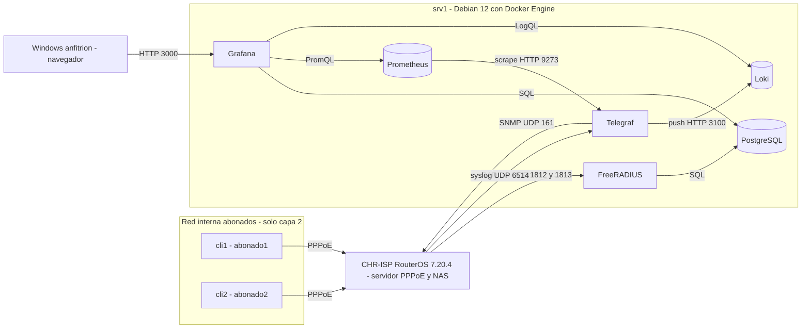

> **Material de consulta.** Esta guía se hizo con IA antes de la reunión del grupo y usa otro diseño (otras IPs, otros nombres de máquinas, abonados Debian). Sirve para consultar comandos y alternativas, pero **no se sigue al pie de la letra**. Ante cualquier diferencia, vale [`plan-de-trabajo.md`](../plan-de-trabajo.md) (sección 15).

# Guía completa: RADIUS, accounting y monitoreo para un ISP simulado

Proyecto final de Administración de Servicios en Linux (UTN). Presentación: jueves 26 de noviembre.

**Cómo leer esta guía**

- Cada bloque termina con un criterio de "terminado". No pases al siguiente si el anterior no lo cumple.
- Cada bloque de comandos indica dónde se ejecuta: VirtualBox, terminal Linux (srv1 o cliente), consola de RouterOS, psql o Grafana.
- Lo marcado con **⚠ Verificar** es algo que no pude comprobar en tu entorno. No es un hecho: es lo esperable, con la forma de confirmarlo al lado.
- Todas las contraseñas y secretos son **valores de ejemplo para laboratorio**. No los reutilicen en nada real.
- Anoten en la bitácora cada decisión, cada error y cómo lo resolvieron. Es lo que van a preguntar.

---

## 0. Mapa general

### 0.1 Qué problema resolvemos

Un ISP tiene muchos routers de acceso y miles de abonados. Si los usuarios se cargaran en cada router, un alta, una baja por falta de pago o un cambio de plan habría que repetirlos equipo por equipo. RADIUS centraliza tres funciones (AAA):

| Función | Pregunta que responde | En nuestro laboratorio |
|---|---|---|
| Autenticación | ¿Sos quien decís ser? | Usuario y contraseña del abonado, guardados en PostgreSQL |
| Autorización | ¿Qué te corresponde? | Velocidad del plan, enviada al router como atributo |
| Accounting | ¿Qué hiciste? | Inicio, fin, duración y bytes de cada sesión, guardados en PostgreSQL |

### 0.2 Roles

| Rol | Quién es | Qué hace |
|---|---|---|
| Abonado | cli1, cli2 | Pide una conexión PPPoE con usuario y contraseña |
| NAS (cliente RADIUS) | CHR-ISP | Termina el PPPoE y le pregunta al servidor RADIUS. Nunca decide solo |
| Servidor RADIUS | FreeRADIUS | Responde Accept o Reject y recibe el accounting |
| Almacén AAA | PostgreSQL | Guarda usuarios, planes, sesiones e intentos de login |
| Recolector | Telegraf | Consulta al router por SNMP y recibe sus logs por syslog |
| Almacén de métricas | Prometheus | Guarda series temporales numéricas |
| Almacén de logs | Loki | Guarda líneas de texto con marca de tiempo |
| Visualización | Grafana | Consulta las tres fuentes y arma el tablero |

Idea clave para la defensa: **el abonado nunca habla RADIUS**. Habla PPPoE con el router, y el router habla RADIUS con el servidor. Por eso el "cliente RADIUS" es el CHR.

### 0.3 Arquitectura



### 0.4 Plan de direcciones (único para toda la guía)

| Elemento | Valor |
|---|---|
| Red solo-anfitrión "servicios" | 192.168.56.0/24 |
| Windows anfitrión | 192.168.56.1 |
| CHR-ISP, ether3 | 192.168.56.10 |
| srv1 | 192.168.56.20 |
| Red interna "abonados" | Sin direccionamiento IP: solo transporta PPPoE |
| Lado router de las sesiones PPPoE | 10.10.0.1 |
| Pool para abonados | 10.10.0.10 a 10.10.0.100 |
| Usuarios | abonado1 (plan-basico), abonado2 (plan-plus) |

| Puerto | Protocolo | Desde → hacia | Para qué |
|---|---|---|---|
| 1812 | UDP | CHR → srv1 | Autenticación RADIUS |
| 1813 | UDP | CHR → srv1 | Accounting RADIUS |
| 161 | UDP | srv1 → CHR | Consultas SNMP |
| 6514 | UDP | CHR → srv1 | Logs por syslog |
| 3000 | TCP | Windows → srv1 | Grafana |
| 9090 | TCP | Windows → srv1 | Prometheus (solo para diagnóstico) |
| 5201 | TCP | abonados → srv1 | iperf3 (tráfico de prueba) |

### 0.5 Decisiones de arquitectura y alternativas descartadas

| Decisión | Elegido | Alternativas | Por qué descartamos las otras | Limitación de lo elegido |
|---|---|---|---|---|
| Dónde corre Docker | Docker Engine en srv1 | Docker Desktop en Windows | Docker Desktop mete NAT y capas de Windows entre el CHR y FreeRADIUS; el servidor podría no ver la IP real del NAS, y el diagnóstico se complica | Hay que instalar Docker y darle RAM a la VM |
| Abonados | Dos VMs Debian con `pppd` | Contenedores; otros CHR como clientes | Los contenedores necesitan redes especiales y privilegios para llegar a la capa 2; un CHR como cliente no genera tráfico tan cómodo con iperf3 | Consume más RAM |
| FreeRADIUS ↔ PostgreSQL | Módulo `sql` oficial con el esquema que trae la propia imagen | Archivo `users`; esquema propio | El archivo plano no escala ni registra accounting; un esquema propio obliga a reescribir las consultas | Atados al esquema estándar |
| Métricas del router | SNMP, consultado por Telegraf | API de RouterOS con un exporter (por ejemplo mktxp); snmp_exporter de Prometheus | SNMP es estándar y sirve para cualquier marca; en Telegraf cada OID queda a la vista y se puede explicar; snmp_exporter esconde los OID en un archivo generado | SNMP v2c no cifra; la comunidad viaja en claro |
| Logs del router | syslog remoto hacia Telegraf, que los pasa a Loki | Grafana Alloy; rsyslog a archivo; guardar logs en PostgreSQL | Un solo recolector para métricas y logs significa una pieza menos que aprender | El parseo depende del formato que emita RouterOS (ver Bloque 9) |
| Almacén de métricas | Prometheus | InfluxDB; guardar todo en PostgreSQL | Prometheus es el estándar con Grafana. Todo en PostgreSQL funcionaría con menos contenedores, pero mezcla tres tipos de datos que conviene distinguir | Un contenedor más |
| Accounting en Grafana | Consulta SQL directa a PostgreSQL | Exportar el accounting como métricas | Los datos ya están en la base; duplicarlos agrega piezas y errores | radacct guarda contadores acumulados por sesión, no una serie temporal |
| RADIUS caído | Sin usuarios locales de respaldo | Dejar `ppp secret` locales | Sin respaldo se ve el efecto real de la caída, que es lo que hay que demostrar | Si RADIUS cae, nadie nuevo conecta |

**Plan de simplificación** si el tiempo no alcanza: eliminar Prometheus y Loki y hacer que Telegraf escriba en PostgreSQL. Baja de seis contenedores a cuatro. No lo hacemos de entrada porque se pierde la distinción entre métrica, log y registro, que es una de las preguntas de la consigna.

### 0.6 Métrica, log y registro de accounting

| | Métrica | Log | Registro de accounting |
|---|---|---|---|
| Qué es | Un número medido a intervalos regulares | Un texto que describe un evento | Una fila que describe una sesión |
| Ejemplo | CPU al 12 % a las 10:00:15 | "abonado1 logged in, 10.10.0.10" | abonado1, inicio 10:00, 35 MB, fin 10:40 |
| Cómo llega | Telegraf pregunta por SNMP (pull) | El router lo envía por syslog (push) | El router lo envía por RADIUS (push) |
| Dónde se guarda | Prometheus | Loki | PostgreSQL |
| Lenguaje de consulta | PromQL | LogQL | SQL |
| Sirve para | Tendencias y alertas | Entender por qué pasó algo | Facturación, auditoría, consumo por abonado |

**Observabilidad** es poder responder preguntas sobre el estado interno de un sistema mirando lo que emite. Nuestro tablero combina las tres fuentes para responder "¿anda el router?", "¿qué hacen los abonados?" y "¿qué pasó cuando algo falló?".

### 0.7 Estructura de archivos en srv1

```
/home/sysadmin/isp-lab/
├── .env
├── docker-compose.yml
├── postgres/
│   └── init/
│       ├── 01-schema.sql        (se extrae de la imagen de FreeRADIUS)
│       ├── 02-abonados.sql
│       └── 03-grafana.sh
├── freeradius/
│   ├── clients.conf
│   └── sql                      (se extrae de la imagen y se editan 7 líneas)
├── telegraf/
│   └── telegraf.conf
├── prometheus/
│   └── prometheus.yml
└── grafana/
    └── provisioning/
        └── datasources/
            └── datasources.yml
```

### 0.8 Cronograma sugerido

| Fecha | Meta |
|---|---|
| 13 al 17-nov | Bloques 1 a 7: un abonado autenticado por RADIUS y con accounting en la base |
| 18 y 19-nov (consulta) | Presentar arquitectura y decisiones; mostrar lo que ande |
| 19 al 23-nov | Bloques 8 a 11: tráfico, métricas, logs y tablero |
| 24-nov | Bloque 12: pruebas de integración y de fallos |
| 25-nov (consulta) | Ensayo completo de la demo; preguntas cruzadas |
| 26-nov | Presentación |

Reparto sugerido para cinco personas (cada uno es dueño de una parte, pero todos deben poder explicarlas todas):

1. Redes de VirtualBox, Docker y PostgreSQL (Bloques 1 y 2).
2. FreeRADIUS, usuarios y planes (Bloques 3 y 4).
3. CHR: PPPoE, RADIUS, SNMP y syslog (Bloques 5 y 6).
4. Abonados, tráfico y plan de pruebas (Bloques 7, 8 y 12).
5. Telegraf, Prometheus, Loki y Grafana (Bloques 9 a 11).

---

## Bloque 1. Redes de VirtualBox y Docker en srv1

**Objetivo:** que CHR-ISP y srv1 se vean por la red de servicios y que Docker funcione.

**Conceptos:** en VirtualBox, una *red interna* es un switch virtual aislado; una red *solo-anfitrión* es un switch al que también está conectado Windows; *NAT* da salida a Internet.

### 1.1 VMs y adaptadores (VirtualBox, en Windows, con las VMs apagadas)

Cloná CHR-Base como `CHR-ISP` y cli1 como `cli2`. En el clonado elegí **generar nuevas direcciones MAC**. Dos equipos con la misma MAC en el mismo segmento producen fallas intermitentes muy difíciles de diagnosticar.

| VM | Adaptador 1 | Adaptador 2 | Adaptador 3 | RAM |
|---|---|---|---|---|
| CHR-ISP | NAT | Red interna `abonados` | Solo-anfitrión | 256 MB |
| srv1 | NAT | Solo-anfitrión | (ninguno) | 4 GB, 2 CPU |
| cli1 | NAT | Red interna `abonados` | (ninguno) | 512 MB |
| cli2 | NAT | Red interna `abonados` | (ninguno) | 512 MB |

En **Archivo → Herramientas → Administrador de red**, confirmá que la red solo-anfitrión sea 192.168.56.1/24. Si tiene otro rango, cambiá las IP de esta guía de forma consistente en lugar de modificar la red.

**Por qué así:** la red interna `abonados` solo conecta a los clientes con el CHR, de modo que la única forma de salir es autenticándose por PPPoE. La red solo-anfitrión permite además abrir Grafana desde el navegador de Windows.

### 1.2 IP del CHR en la red de servicios (consola de RouterOS)

Primero confirmá qué interfaz corresponde a cada adaptador comparando las MAC con las de VirtualBox:

```
/interface/ethernet/print
```

Lo esperable es adaptador 1 = `ether1`, 2 = `ether2`, 3 = `ether3`. **⚠ Verificar** con las MAC; si no coincide, adaptá los nombres en toda la guía.

```
/system/identity/set name=CHR-ISP
/ip/address/add address=192.168.56.10/24 interface=ether3 comment="red servicios"
/ip/address/print
```

Resultado esperado: una línea con `192.168.56.10/24` en `ether3`, sin la marca `I` (inválida).

### 1.3 IP fija y ruta en srv1 (terminal Linux, srv1)

Mirá primero cómo está configurada la red:

```bash
ip -br addr
cat /etc/network/interfaces
systemctl is-active networking NetworkManager systemd-networkd
```

**⚠ Verificar:** lo que sigue supone que srv1 usa `ifupdown` (servicio `networking` activo y archivo `/etc/network/interfaces`), que es lo habitual en un Debian 12 sin entorno gráfico, y que la segunda interfaz se llama `enp0s8`. Si tu salida muestra otra cosa, no apliques este archivo y consultalo.

Agregá al final de `/etc/network/interfaces`:

```
auto enp0s8
iface enp0s8 inet static
    address 192.168.56.20/24
    up ip route add 10.10.0.0/24 via 192.168.56.10
```

```bash
sudo ifup enp0s8
ip -br addr show enp0s8
ip route
```

**Qué hace cada línea:** `address` fija la IP sin gateway, porque la salida a Internet sigue por el NAT. La línea `up ip route add` le dice a srv1 que la red de los abonados (10.10.0.0/24) se alcanza a través del CHR. Sin esa ruta, srv1 recibiría los paquetes de iperf3 de los abonados pero respondería por el NAT, y el tráfico de prueba no funcionaría.

### 1.4 Docker Engine (terminal Linux, srv1)

Procedimiento de la documentación oficial de Docker para Debian:

```bash
sudo apt update
sudo apt install ca-certificates curl
sudo install -m 0755 -d /etc/apt/keyrings
sudo curl -fsSL https://download.docker.com/linux/debian/gpg -o /etc/apt/keyrings/docker.asc
sudo chmod a+r /etc/apt/keyrings/docker.asc

sudo tee /etc/apt/sources.list.d/docker.sources <<EOF
Types: deb
URIs: https://download.docker.com/linux/debian
Suites: $(. /etc/os-release && echo "$VERSION_CODENAME")
Components: stable
Architectures: $(dpkg --print-architecture)
Signed-By: /etc/apt/keyrings/docker.asc
EOF

sudo apt update
sudo apt install docker-ce docker-ce-cli containerd.io docker-buildx-plugin docker-compose-plugin
sudo usermod -aG docker $USER
```

Cerrá sesión y volvé a entrar para que el grupo tenga efecto.

**Qué hace cada parte:** la clave GPG permite a `apt` verificar que los paquetes vienen de Docker; el archivo `.sources` agrega su repositorio (el Docker que trae Debian es más viejo); el último `apt install` instala el motor, el cliente y el plugin de Compose. `usermod` evita escribir `sudo` en cada comando. Ojo: pertenecer al grupo `docker` equivale en la práctica a ser root en esa máquina.

### 1.5 Validación

```bash
# Terminal Linux, srv1
docker run hello-world
docker compose version
ping -c 3 192.168.56.10
```

```
# Consola de RouterOS
/ping 192.168.56.20 count=3
```

```powershell
# PowerShell, Windows
ping 192.168.56.20
```

**Terminado cuando:** `hello-world` imprime su mensaje, Compose informa versión y los tres pings responden.

| Síntoma | Causa probable | Cómo comprobarlo |
|---|---|---|
| srv1 no llega al CHR | IP en la interfaz equivocada | Comparar MAC entre RouterOS y VirtualBox |
| Nadie ve la red .56 | Adaptador solo-anfitrión inexistente o con otro rango | Administrador de red de VirtualBox |
| `apt update` falla | Sin salida por NAT | `ping -c 3 1.1.1.1` y `ip route` |
| "permission denied" en docker | Falta volver a iniciar sesión | `groups` debe listar `docker` |

---

## Bloque 2. PostgreSQL con el esquema de FreeRADIUS

**Objetivo:** una base `radius` con las tablas que FreeRADIUS espera, dos abonados de prueba y un usuario de solo lectura para Grafana.

**Conceptos:**

- FreeRADIUS no inventa tablas: trae un `schema.sql` por motor de base de datos. Usamos **el de la misma imagen** que vamos a ejecutar, para que tablas y consultas coincidan.
- La imagen oficial de PostgreSQL ejecuta, **solo la primera vez** que se crea el volumen de datos, todo lo que encuentra en `/docker-entrypoint-initdb.d`, en orden alfabético.

### 2.1 Carpeta de trabajo y archivo de variables (terminal Linux, srv1)

```bash
mkdir -p ~/isp-lab/postgres/init ~/isp-lab/freeradius ~/isp-lab/telegraf \
         ~/isp-lab/prometheus ~/isp-lab/grafana/provisioning/datasources
cd ~/isp-lab
```

Archivo `~/isp-lab/.env`:

```
# Valores de EJEMPLO para laboratorio. No reutilizar.
RADIUS_DB_PASSWORD=LabRadiusDB-2026
GRAFANA_DB_PASSWORD=LabGrafanaRO-2026
GRAFANA_ADMIN_PASSWORD=LabGrafanaAdmin-2026
```

```bash
chmod 600 .env
```

**Por qué un `.env`:** saca las contraseñas del `docker-compose.yml`, que es el archivo que uno muestra y versiona. Si usan git, agreguen `.env` al `.gitignore`.

### 2.2 Extraer el esquema desde la imagen de FreeRADIUS

```bash
docker pull freeradius/freeradius-server:latest-3.2
docker run --rm --entrypoint cat freeradius/freeradius-server:latest-3.2 \
  /etc/raddb/mods-config/sql/main/postgresql/schema.sql > postgres/init/01-schema.sql
grep -c "CREATE TABLE" postgres/init/01-schema.sql
```

Resultado esperado: un número mayor que cero (del orden de 8 a 10 tablas). Si da 0 o el archivo está vacío, la ruta dentro de la imagen es otra; buscala así:

```bash
docker run --rm --entrypoint find freeradius/freeradius-server:latest-3.2 / -name schema.sql -path "*postgresql*"
```

Aprovechá para comprobar que la imagen trae el driver de PostgreSQL:

```bash
docker run --rm --entrypoint find freeradius/freeradius-server:latest-3.2 / -name "rlm_sql_postgresql*"
```

**⚠ Verificar:** tiene que devolver al menos un archivo `.so`. Si no devuelve nada, la imagen no trae el driver y hay que construir una imagen propia; frená acá y consultalo.

### 2.3 Abonados y planes

Archivo `postgres/init/02-abonados.sql`:

```sql
-- Abonados de laboratorio. Contraseñas de EJEMPLO.
INSERT INTO radcheck (username, attribute, op, value) VALUES
  ('abonado1', 'Cleartext-Password', ':=', 'clave-lab-1'),
  ('abonado2', 'Cleartext-Password', ':=', 'clave-lab-2');

-- A qué plan pertenece cada abonado.
INSERT INTO radusergroup (username, groupname, priority) VALUES
  ('abonado1', 'plan-basico', 1),
  ('abonado2', 'plan-plus',   1);

-- Qué recibe cada plan: límite de velocidad "subida/bajada" visto desde el abonado.
INSERT INTO radgroupreply (groupname, attribute, op, value) VALUES
  ('plan-basico', 'Mikrotik-Rate-Limit', ':=', '256k/512k'),
  ('plan-plus',   'Mikrotik-Rate-Limit', ':=', '512k/768k');
```

**Qué significa cada tabla:**

| Tabla | Para qué | Etapa AAA |
|---|---|---|
| `radcheck` | Lo que se **verifica** del usuario (su contraseña) | Autenticación |
| `radreply` | Atributos que se **devuelven** a un usuario puntual | Autorización |
| `radusergroup` | A qué grupo (plan) pertenece cada usuario | Autorización |
| `radgroupcheck` / `radgroupreply` | Verificaciones y respuestas por grupo | Autorización |
| `radacct` | Una fila por sesión: inicio, fin, bytes | Accounting |
| `radpostauth` | Un registro por intento de login, aceptado o rechazado | Auditoría |

**Por qué `Cleartext-Password`:** PPPoE suele autenticar con CHAP o MS-CHAPv2, donde la contraseña nunca viaja; el servidor necesita conocerla para recalcular el desafío. Un hash común no sirve para eso. En producción se protege la base, no se confía en que la clave esté hasheada.

**Por qué planes por grupo:** así un ISP cambia la velocidad de mil abonados modificando una sola fila. Las velocidades son bajas a propósito: la licencia Free del CHR limita cada interfaz a 1 Mbps de subida, y queremos medir el plan del abonado, no el tope de la licencia.

### 2.4 Usuario de solo lectura para Grafana

Archivo `postgres/init/03-grafana.sh`:

```bash
#!/bin/bash
set -e
psql -v ON_ERROR_STOP=1 --username "$POSTGRES_USER" --dbname "$POSTGRES_DB" <<EOSQL
CREATE ROLE grafana_ro LOGIN PASSWORD '${GRAFANA_DB_PASSWORD}';
GRANT CONNECT ON DATABASE radius TO grafana_ro;
GRANT USAGE ON SCHEMA public TO grafana_ro;
GRANT SELECT ON radacct, radpostauth, radusergroup, radgroupreply TO grafana_ro;
EOSQL
```

```bash
chmod +x postgres/init/03-grafana.sh
```

**Por qué:** Grafana solo necesita leer. Con un rol aparte, un error o una inyección en un panel no puede borrar datos. Notá que **no** le damos acceso a `radcheck`: ahí están las contraseñas.

### 2.5 docker-compose.yml completo

Este archivo define todos los servicios del proyecto. Los vas a ir levantando de a uno.

Archivo `~/isp-lab/docker-compose.yml`:

```yaml
name: isp-lab

services:
  postgres:
    image: postgres:17
    restart: unless-stopped
    environment:
      POSTGRES_DB: radius
      POSTGRES_USER: radius
      POSTGRES_PASSWORD: ${RADIUS_DB_PASSWORD}
      GRAFANA_DB_PASSWORD: ${GRAFANA_DB_PASSWORD}
    volumes:
      - pgdata:/var/lib/postgresql/data
      - ./postgres/init:/docker-entrypoint-initdb.d:ro
    healthcheck:
      test: ["CMD-SHELL", "pg_isready -U radius -d radius"]
      interval: 5s
      timeout: 3s
      retries: 10

  freeradius:
    image: freeradius/freeradius-server:latest-3.2
    restart: unless-stopped
    depends_on:
      postgres:
        condition: service_healthy
    ports:
      - "192.168.56.20:1812:1812/udp"
      - "192.168.56.20:1813:1813/udp"
    volumes:
      - ./freeradius/clients.conf:/etc/raddb/clients.conf:ro
      - ./freeradius/sql:/etc/raddb/mods-enabled/sql:ro

  telegraf:
    image: telegraf:1.34
    restart: unless-stopped
    ports:
      - "192.168.56.20:6514:6514/udp"
    volumes:
      - ./telegraf/telegraf.conf:/etc/telegraf/telegraf.conf:ro

  prometheus:
    image: prom/prometheus:v3.4.0
    restart: unless-stopped
    ports:
      - "192.168.56.20:9090:9090"
    volumes:
      - ./prometheus/prometheus.yml:/etc/prometheus/prometheus.yml:ro
      - promdata:/prometheus

  loki:
    image: grafana/loki:3.5.0
    restart: unless-stopped
    command: -config.file=/etc/loki/local-config.yaml
    volumes:
      - lokidata:/loki

  grafana:
    image: grafana/grafana:12.0.0
    restart: unless-stopped
    depends_on:
      - postgres
      - prometheus
      - loki
    ports:
      - "192.168.56.20:3000:3000"
    environment:
      GF_SECURITY_ADMIN_USER: admin
      GF_SECURITY_ADMIN_PASSWORD: ${GRAFANA_ADMIN_PASSWORD}
      GRAFANA_DB_PASSWORD: ${GRAFANA_DB_PASSWORD}
    volumes:
      - grafanadata:/var/lib/grafana
      - ./grafana/provisioning:/etc/grafana/provisioning:ro

volumes:
  pgdata:
  promdata:
  lokidata:
  grafanadata:
```

**Decisiones dentro del archivo, para poder defenderlas:**

- **Versiones fijadas** en vez de `latest`: el proyecto tiene que levantar igual el 26 que hoy. **⚠ Verificar:** son versiones que conozco como publicadas; si algún `pull` falla por tag inexistente, usá el más cercano del mismo número mayor y anotalo.
- **PostgreSQL 17**: versión mayor fija porque el volumen de datos no es compatible entre versiones mayores.
- **Volúmenes con nombre** (`pgdata` y los demás): los datos sobreviven a `docker compose down`. Solo se borran con `down -v`.
- **PostgreSQL no publica ningún puerto**: solo lo alcanzan los otros contenedores por la red interna de Compose. Es la superficie de ataque mínima.
- **Puertos atados a 192.168.56.20**: los servicios escuchan solo en la red de servicios, no en la interfaz NAT.
- **`depends_on` con `service_healthy`**: FreeRADIUS arranca recién cuando PostgreSQL acepta conexiones; si no, fallaría al iniciar.
- **Nombres de servicio como nombres DNS**: dentro de la red de Compose, `postgres`, `loki` o `prometheus` resuelven a la IP del contenedor. Por eso las configuraciones usan esos nombres y no direcciones IP.
- **Montajes `:ro`**: los contenedores leen la configuración pero no pueden modificarla.

### 2.6 Levantar y validar (terminal Linux, srv1)

```bash
cd ~/isp-lab
docker compose up -d postgres
docker compose ps
docker compose logs postgres | tail -n 30
```

```bash
docker compose exec postgres psql -U radius -d radius -c '\dt'
docker compose exec postgres psql -U radius -d radius -c 'SELECT username, attribute, op FROM radcheck;'
docker compose exec postgres psql -U radius -d radius -c '\d radacct'
```

Resultado esperado: la lista de tablas incluye `radacct`, `radcheck`, `radgroupreply`, `radpostauth` y `radusergroup`; `radcheck` muestra los dos abonados. **Guardá la salida de `\d radacct`**: es el esquema real, y las consultas del Bloque 10 dependen de esos nombres de columna.

**Terminado cuando:** el servicio figura `healthy`, existen las tablas y están los dos abonados.

| Síntoma | Causa probable | Qué hacer |
|---|---|---|
| No hay tablas | El volumen ya existía y los scripts de inicio no se volvieron a ejecutar | `docker compose down -v` y levantar de nuevo (borra los datos) |
| Error en `03-grafana.sh` | Falta permiso de ejecución o `.env` incompleto | `ls -l postgres/init`, revisar `.env` |
| Error de sintaxis en `01-schema.sql` | El archivo se extrajo vacío o incompleto | Repetir el paso 2.2 |

---

## Bloque 3. FreeRADIUS conectado a PostgreSQL

**Objetivo:** que FreeRADIUS lea los usuarios de la base y acepte consultas del CHR.

**Conceptos:**

- FreeRADIUS es modular. Los módulos disponibles están en `mods-available/`; los activos, en `mods-enabled/`. Montar nuestro archivo `sql` directamente en `mods-enabled/` equivale a activarlo.
- `clients.conf` lista qué equipos (NAS) pueden consultar al servidor. Cada uno se identifica por **IP de origen** y **secreto compartido**. El secreto nunca viaja por la red: se usa para firmar los paquetes y cifrar la contraseña.
- La imagen oficial, sin configuración propia, solo acepta clientes de prueba en 127.0.0.1, así que hay que definir el nuestro sí o sí.

### 3.1 clients.conf

Archivo `freeradius/clients.conf`:

```
# NAS real: el MikroTik CHR
client chr-isp {
	ipaddr = 192.168.56.10
	secret = SecretoLab-Radius-2026
	shortname = chr-isp
}

# Cliente local, solo para pruebas con radtest dentro del contenedor
client localhost {
	ipaddr = 127.0.0.1
	secret = testing123
}
```

### 3.2 Módulo sql

En lugar de escribir el archivo desde cero, partimos del que trae la imagen y cambiamos solo lo necesario. Así no dependemos de recordar todas las opciones de esa versión.

```bash
cd ~/isp-lab
docker run --rm --entrypoint cat freeradius/freeradius-server:latest-3.2 \
  /etc/raddb/mods-available/sql > freeradius/sql
```

Editá `freeradius/sql` y dejá estas líneas con estos valores. Algunas vienen comentadas con `#`: hay que descomentarlas.

| Línea original (aproximada) | Debe quedar | Qué hace |
|---|---|---|
| `dialect = "sqlite"` | `dialect = "postgresql"` | Elige el juego de consultas SQL para PostgreSQL |
| `driver = "rlm_sql_null"` | `driver = "rlm_sql_${dialect}"` | Carga el driver real en vez del que no hace nada |
| `#	server = "localhost"` | `server = "postgres"` | Nombre del servicio en Compose |
| `#	port = 3306` | `port = 5432` | Puerto de PostgreSQL |
| `#	login = "radius"` | `login = "radius"` | Usuario de la base |
| `#	password = "radpass"` | `password = "LabRadiusDB-2026"` | Debe coincidir con `RADIUS_DB_PASSWORD` del `.env` |
| `radius_db = "radius"` | `radius_db = "radius"` | Nombre de la base (ya suele estar bien) |

**⚠ Verificar:** el texto exacto de las líneas originales puede variar entre versiones. Buscalas con:

```bash
grep -nE '^\s*#?\s*(dialect|driver|server|port|login|password|radius_db) =' freeradius/sql
```

Tiene que quedar **una sola** línea activa (sin `#`) para cada una de las siete claves dentro del bloque `sql { }`. Si `driver` aparece activa dos veces, FreeRADIUS no arranca.

**Por qué no hace falta tocar `sites-enabled/default`:** en la serie 3.2, el sitio por defecto ya incluye `-sql` en las secciones `authorize`, `accounting` y `post-auth`. El guion significa "usalo si el módulo está activo". **⚠ Verificar** en el paso 3.3: en la salida de depuración tiene que aparecer `sql` al procesar un pedido.

### 3.3 Levantar en modo depuración (terminal Linux, srv1)

El modo depuración (`-X`) es la herramienta principal de diagnóstico de FreeRADIUS: muestra cada paquete recibido, cada módulo ejecutado y cada consulta SQL.

```bash
cd ~/isp-lab
docker compose run --rm --service-ports freeradius -X
```

Resultado esperado: mucho texto que termina en `Ready to process requests`. Dejalo corriendo en esa terminal.

Si termina con error, leé las últimas 20 líneas: el mensaje casi siempre nombra el archivo y la línea.

| Mensaje | Causa probable |
|---|---|
| `Could not link driver rlm_sql_postgresql` | La imagen no trae el driver (ver 2.2) |
| `Couldn't connect ... PostgreSQL` | `server`, `password` o la base no están bien; o postgres no está levantado |
| `Duplicate configuration item` o error de parseo en `sql` | Quedó una línea duplicada o mal descomentada |
| `Refusing to start ... globally writable` | Permisos demasiado abiertos: `chmod 644 freeradius/sql freeradius/clients.conf` |

### 3.4 Probar la autenticación sin el router

En **otra terminal** de srv1, buscá el nombre del contenedor en ejecución y probá desde adentro:

```bash
docker ps --format '{{.Names}}' | grep freeradius
docker exec -it NOMBRE_DEL_CONTENEDOR radtest abonado1 clave-lab-1 127.0.0.1 0 testing123
docker exec -it NOMBRE_DEL_CONTENEDOR radtest abonado1 clave-incorrecta 127.0.0.1 0 testing123
```

Resultado esperado: el primero responde `Access-Accept` y muestra `Mikrotik-Rate-Limit = "256k/512k"`; el segundo responde `Access-Reject`.

**⚠ Verificar:** si `radtest` no existe dentro de la imagen, salteá esta prueba y validá directamente con el router en el Bloque 6.

En la terminal de depuración tenés que ver la consulta a `radcheck`, la de `radusergroup` y la de `radgroupreply`. Ese rastro es la mejor explicación visual de cómo FreeRADIUS usa la base.

Comprobá que el intento quedó registrado:

```bash
docker compose exec postgres psql -U radius -d radius \
  -c 'SELECT username, reply, authdate FROM radpostauth ORDER BY authdate DESC LIMIT 5;'
```

### 3.5 Dejarlo como servicio

Cortá el modo depuración con Ctrl+C y levantalo normal:

```bash
docker compose up -d freeradius
docker compose ps
```

Cuando necesites depurar de nuevo: `docker compose stop freeradius` y repetí 3.3.

**Terminado cuando:** `Access-Accept` con el atributo de velocidad para la clave correcta, `Access-Reject` para la incorrecta, y ambos intentos en `radpostauth`.

---

## Bloque 4. Qué acabamos de construir (autorización y planes)

No hay configuración nueva: es el momento de entender el recorrido antes de sumar el router.

Cuando llega un `Access-Request` para `abonado1`:

1. FreeRADIUS comprueba que el paquete viene de un cliente listado en `clients.conf` y que el secreto coincide. Si no, **lo descarta sin responder**.
2. Sección `authorize`: el módulo `sql` busca al usuario en `radcheck` y obtiene su contraseña; después busca sus grupos en `radusergroup` y los atributos del grupo en `radgroupreply`.
3. Sección `authenticate`: según el método (PAP, CHAP o MS-CHAP), el módulo correspondiente compara lo recibido con la contraseña conocida.
4. Sección `post-auth`: el módulo `sql` inserta una fila en `radpostauth` con el resultado.
5. Responde `Access-Accept` con los atributos de respuesta, o `Access-Reject`.

**Operadores de las tablas:** `:=` significa "asignar, pisando cualquier valor previo". `==` significa "comparar". Para contraseñas y atributos de respuesta usamos `:=`.

**Experimento para la bitácora:** cambiá el plan de un abonado y comprobá que no hace falta reiniciar nada.

```bash
docker compose exec postgres psql -U radius -d radius \
  -c "UPDATE radusergroup SET groupname='plan-plus' WHERE username='abonado1';"
```

Repetí el `radtest` y mirá que cambia `Mikrotik-Rate-Limit`. Después volvé a dejarlo en `plan-basico`. Eso es administración centralizada, y es el argumento central de por qué un ISP usa RADIUS.

---

## Bloque 5. MikroTik CHR como servidor PPPoE

**Objetivo:** que el CHR ofrezca PPPoE en la red de abonados.

**Conceptos:**

- **PPP** es un protocolo punto a punto que negocia autenticación y direcciones IP. **PPPoE** lo encapsula sobre Ethernet, para usarlo en redes compartidas.
- PPPoE tiene una fase de descubrimiento por broadcast (PADI, PADO, PADR, PADS) y recién después arranca PPP. Por eso cliente y servidor tienen que estar en el mismo segmento Ethernet.
- Por cada abonado conectado, RouterOS crea una interfaz dinámica llamada `<pppoe-USUARIO>`.

Todo lo que sigue es en la **consola de RouterOS** del CHR-ISP.

```
/ip/pool/add name=pool-abonados ranges=10.10.0.10-10.10.0.100

/ppp/profile/add name=perfil-abonados local-address=10.10.0.1 remote-address=pool-abonados dns-server=1.1.1.1

/interface/pppoe-server/server/add service-name=isp-lab interface=ether2 default-profile=perfil-abonados one-session-per-host=yes disabled=no
```

| Comando | Qué hace | Por qué así |
|---|---|---|
| `/ip/pool/add` | Define el rango de IP para los abonados | El router asigna la IP; RADIUS decide el plan. Más simple que asignar IP desde RADIUS |
| `/ppp/profile/add` | Plantilla de sesión: IP del lado router, de dónde sale la del abonado, DNS | Un perfil único; la velocidad no va acá porque la manda RADIUS |
| `/interface/pppoe-server/server/add` | Escucha pedidos PPPoE en `ether2` | `one-session-per-host=yes` evita sesiones duplicadas desde la misma MAC |

Salida a Internet para los abonados. Primero mirá si la base ya tiene una regla de NAT:

```
/ip/firewall/nat/print
```

Si no hay una regla `masquerade` con `out-interface=ether1`, agregala:

```
/ip/firewall/nat/add chain=srcnat out-interface=ether1 action=masquerade comment="salida abonados"
```

Hora correcta (importante: accounting y logs llevan marca de tiempo):

```
/system/clock/set time-zone-name=America/Argentina/Mendoza
/system/ntp/client/set enabled=yes servers=pool.ntp.org
/system/clock/print
```

**Validación:**

```
/interface/pppoe-server/server/print
/ppp/profile/print
/ip/pool/print
```

**Terminado cuando:** el servidor PPPoE aparece sin la marca `X` (deshabilitado) sobre `ether2`, y el reloj muestra la hora correcta.

---

## Bloque 6. Integrar el CHR con RADIUS

**Objetivo:** que el CHR consulte a FreeRADIUS para autenticar las sesiones PPP y le envíe accounting.

**Conceptos:**

- En RouterOS hay que hacer dos cosas distintas: **definir el servidor** (`/radius`) y **decirle al servicio PPP que lo use** (`/ppp/aaa`). Olvidar la segunda es el error más común.
- Según la documentación de MikroTik, RouterOS consulta a RADIUS solo si no encuentra al usuario en su base local (`/ppp/secret`). Por eso no creamos usuarios locales.
- `interim-update` hace que el router envíe actualizaciones periódicas de accounting durante la sesión. Sin eso, los bytes solo se conocen al cerrar.

**Consola de RouterOS:**

```
/radius/add service=ppp address=192.168.56.20 secret=SecretoLab-Radius-2026 src-address=192.168.56.10 authentication-port=1812 accounting-port=1813 timeout=3s comment="FreeRADIUS en srv1"

/ppp/aaa/set use-radius=yes accounting=yes interim-update=1m

/radius/print detail
/ppp/aaa/print
/ppp/secret/print
```

| Parámetro | Qué hace | Por qué ese valor |
|---|---|---|
| `service=ppp` | Usa este servidor para sesiones PPP (incluye PPPoE) | No queremos que afecte el login de administración |
| `secret` | Secreto compartido | Idéntico al de `clients.conf` |
| `src-address` | IP con la que salen los pedidos | Garantiza que FreeRADIUS vea 192.168.56.10, que es la IP autorizada |
| `timeout=3s` | Cuánto espera cada respuesta | El valor por defecto cambia según la versión de la documentación, así que lo fijamos. En un laboratorio con VMs, 3 s evita falsos timeouts |
| `use-radius=yes` | PPP consulta a RADIUS | Sin esto, el servidor definido arriba no se usa |
| `accounting=yes` | Envía Start, Interim y Stop | Requisito de la consigna |
| `interim-update=1m` | Actualización cada minuto | En un ISP real serían 5 a 15 minutos; usamos 1 para que la demo se vea en vivo |

`/ppp/secret/print` tiene que salir **vacío**. Si la base traía usuarios locales con el mismo nombre que un abonado, se autenticarían localmente y nunca verías tráfico RADIUS.

**Validación sin abonados todavía.** RouterOS lleva contadores por servidor RADIUS:

```
/radius/monitor 0 once
```

Por ahora están en cero. Después de la primera conexión (Bloque 7) vas a mirar:

| Contador | Si crece significa |
|---|---|
| `accepts` | El servidor aceptó |
| `rejects` | El servidor rechazó (credenciales) |
| `timeouts` | No llegó respuesta: red, puerto, o secreto incorrecto (FreeRADIUS descarta en silencio) |
| `bad-replies` | Llegó respuesta pero no pasó la validación: secreto distinto o problema de autenticación del mensaje |

**⚠ Verificar:** las versiones recientes de RouterOS y de FreeRADIUS endurecieron la validación del atributo Message-Authenticator. Si aparecen `bad-replies` con el secreto correcto, revisá con `/radius/print detail` si existe una opción relacionada con *message-auth* y consultalo antes de cambiarla.

**Terminado cuando:** `/radius/print` muestra el servidor sin marca `X`, `/ppp/aaa/print` muestra `use-radius: yes` y `accounting: yes`, y no hay secretos locales.

---

## Bloque 7. Abonados PPPoE (cli1 y cli2)

**Objetivo:** dos sesiones PPPoE autenticadas por RADIUS.

**Conceptos:** en Linux, `pppd` es el demonio que habla PPP. El plugin PPPoE le permite hacerlo sobre una interfaz Ethernet. Los archivos en `/etc/ppp/peers/` definen conexiones con nombre.

Hacé todo en cli1 y repetilo en cli2 cambiando usuario y contraseña.

### 7.1 Paquetes (terminal Linux, cliente, con el adaptador NAT todavía conectado)

```bash
sudo apt update
sudo apt install ppp iperf3
ip -br link
```

Anotá el nombre de la interfaz conectada a la red interna `abonados` (lo esperable es `enp0s8`). **⚠ Verificar** comparando la MAC con el adaptador 2 en VirtualBox.

### 7.2 Interfaz de la red de abonados

Agregá al final de `/etc/network/interfaces` del cliente (misma salvedad que en 1.3 sobre `ifupdown`):

```
auto enp0s8
iface enp0s8 inet manual
    up ip link set $IFACE up
```

```bash
sudo ifup enp0s8
```

**Por qué `manual`:** esa interfaz no lleva IP. Solo tiene que estar levantada para transportar PPPoE; la IP la va a tener la interfaz `ppp0`.

### 7.3 Conexión PPPoE

Archivo `/etc/ppp/peers/isp` (en cli1):

```
plugin rp-pppoe.so
enp0s8
user "abonado1"
noauth
defaultroute
replacedefaultroute
usepeerdns
persist
maxfail 0
hide-password
noipdefault
```

| Opción | Qué hace |
|---|---|
| `plugin rp-pppoe.so` | Carga el soporte PPPoE. **⚠ Verificar:** ese es el nombre en el `ppp` 2.4.9 de Debian 12; en `ppp` 2.5 se llama `pppoe.so`. Comprobá con `ls /usr/lib/pppd/*/` |
| `enp0s8` | Interfaz Ethernet donde buscar el servidor PPPoE |
| `user` | Usuario a presentar; la clave se busca en los archivos de secretos |
| `noauth` | No exigimos que el servidor se autentique ante nosotros |
| `defaultroute`, `replacedefaultroute` | La ruta por defecto pasa a ser el enlace PPP |
| `usepeerdns` | Toma el DNS que entrega el servidor |
| `persist`, `maxfail 0` | Reintenta indefinidamente si se cae |
| `noipdefault` | La IP la asigna el servidor |

Agregá esta línea a `/etc/ppp/chap-secrets` **y** a `/etc/ppp/pap-secrets` (en cli2: `abonado2` y `clave-lab-2`):

```
"abonado1" * "clave-lab-1"
```

**Por qué en los dos archivos:** el método (PAP, CHAP, MS-CHAP) lo negocian cliente y servidor; así funciona con cualquiera.

### 7.4 Dejar PPPoE como único camino

Apagá la VM cliente, y en VirtualBox desmarcá **"Cable conectado"** en el adaptador 1 (NAT). Encendela de nuevo. Ahora la única salida posible es la sesión PPPoE.

### 7.5 Conectar y validar

En srv1, dejá FreeRADIUS en modo depuración (paso 3.3) para ver la primera conexión en vivo.

```bash
# Terminal Linux, cliente
sudo pon isp
sleep 5
ip -br addr show ppp0
plog
ping -c 3 10.10.0.1
ping -c 3 192.168.56.20
```

Resultado esperado: `ppp0` con una IP de 10.10.0.10 a 10.10.0.100, y los dos pings responden.

```
# Consola de RouterOS
/ppp/active/print
/queue/simple/print
/radius/monitor 0 once
```

Resultado esperado: una fila por abonado en `/ppp/active` con la columna `radius` activa; una cola dinámica por abonado con el límite de su plan (esa es la **autorización** funcionando); y `accepts` mayor que cero.

En la terminal de depuración de FreeRADIUS deberías ver, en orden: `Access-Request`, `Access-Accept` y luego `Accounting-Request` con `Acct-Status-Type = Start`. Mirá ahí también la **IP de origen** del paquete: tiene que ser 192.168.56.10. Esa es la comprobación de la hipótesis por la que elegimos Docker en srv1.

Para desconectar: `sudo poff isp`.

**Terminado cuando:** las dos sesiones aparecen en `/ppp/active/print`, cada una con su cola, y `radacct` tiene filas (lo vemos en el Bloque 10).

| Síntoma | Causa probable | Cómo distinguirla |
|---|---|---|
| `plog`: "Timeout waiting for PADO" | El cliente no llega al servidor PPPoE: red interna distinta, interfaz caída o servidor deshabilitado | `ip -br link` en el cliente; nombre de la red interna en VirtualBox; `/interface/pppoe-server/server/print` |
| `plog`: "authentication failed" y `rejects` crece | Usuario o clave incorrectos | Depuración de FreeRADIUS: muestra qué clave esperaba |
| "authentication failed" y `timeouts` crece | El router no recibe respuesta | `sudo tcpdump -ni enp0s8 udp port 1812` en srv1: si llegan pedidos pero no salen respuestas, es secreto o `clients.conf` |
| Conecta pero no aparece en RADIUS | Existe un secreto local con ese usuario, o falta `use-radius=yes` | `/ppp/secret/print`, `/ppp/aaa/print` |
| Conecta pero sin cola | El atributo de velocidad no llegó | Buscar `Mikrotik-Rate-Limit` en el `Access-Accept` de la depuración |
| El cliente no llega a srv1 | Falta la ruta de 1.3 en srv1 | `ip route` en srv1 debe mostrar 10.10.0.0/24 vía 192.168.56.10 |

---

## Bloque 8. Generar tráfico reproducible

**Objetivo:** tráfico controlado y repetible por cada abonado.

**Por qué iperf3 contra srv1 y no "navegar":** no depende de Internet el día de la demo, y permite elegir tasa, sentido y duración.

```bash
# Terminal Linux, srv1 (dejarlo corriendo)
sudo apt install iperf3
iperf3 -s
```

```bash
# Terminal Linux, cli1: 2 minutos de subida a 200 kbit/s
iperf3 -c 192.168.56.20 -b 200K -t 120

# Terminal Linux, cli2: 2 minutos de bajada a 400 kbit/s
iperf3 -c 192.168.56.20 -b 400K -t 120 -R
```

| Opción | Significado |
|---|---|
| `-c` | Modo cliente, contra esa IP |
| `-b 200K` | Tasa objetivo. La mantenemos por debajo del plan y del tope de 1 Mbps de la licencia Free |
| `-t 120` | Duración en segundos; más de un minuto para que entre al menos un Interim-Update |
| `-R` | Invierte el sentido: el servidor envía y el abonado descarga |

**Experimento de autorización:** corré `iperf3 -c 192.168.56.20 -t 30` (sin `-b`) en cli1. El resultado debería acercarse a 256 kbit/s, que es el límite de subida del plan básico. Es la demostración más clara de que el atributo que guardamos en PostgreSQL termina limitando tráfico real.

**Validación en el router (consola de RouterOS):**

```
/interface/print stats where name~"pppoe"
```

**Terminado cuando:** los contadores de bytes de las interfaces `<pppoe-abonadoN>` crecen mientras corre iperf3.

---

## Bloque 9. Métricas y logs del router

**Objetivo:** CPU, memoria y tráfico por interfaz en Prometheus; logs del router en Loki.

**Conceptos:**

- **SNMP** es un protocolo de consulta: un gestor pregunta por valores identificados por un **OID** (un número jerárquico). El router solo responde.
- **syslog** es un protocolo de envío de logs: el router manda cada evento apenas ocurre.
- **Telegraf** es un agente con plugins de entrada y de salida. Acá usa dos entradas (SNMP y syslog) y dos salidas (Prometheus y Loki).
- Modelo **pull** de Prometheus: no recibe datos, va a buscarlos. Telegraf publica las métricas en una página HTTP y Prometheus la lee cada 15 segundos.

### 9.1 SNMP en el CHR (consola de RouterOS)

```
/snmp/community/add name=lab-monitoreo addresses=192.168.56.20/32
/snmp/community/print
/snmp/set enabled=yes contact="equipo ASL" location="laboratorio"
```

**Por qué una comunidad propia restringida a una IP:** la comunidad funciona como contraseña de lectura. La de fábrica (`public`) la conoce todo el mundo. Limitamos además quién puede consultar: solo srv1. Si en el `print` la comunidad `public` figura habilitada para cualquier dirección, restringila también:

```
/snmp/community/set [find name=public] addresses=127.0.0.1/32
```

### 9.2 Syslog remoto en el CHR (consola de RouterOS)

```
/system/logging/action/add name=a-srv1 target=remote remote=192.168.56.20 remote-port=6514 remote-log-format=syslog src-address=192.168.56.10

/system/logging/add topics=info action=a-srv1
/system/logging/add topics=warning action=a-srv1
/system/logging/add topics=error action=a-srv1
/system/logging/add topics=critical action=a-srv1
/system/logging/add topics=pppoe action=a-srv1
/system/logging/add topics=ppp action=a-srv1

/system/logging/print
```

| Parámetro | Qué hace |
|---|---|
| `target=remote` | El destino es un servidor externo, no la memoria del router |
| `remote`, `remote-port` | A dónde enviar. Usamos 6514 porque es el puerto por defecto del receptor de Telegraf y no requiere privilegios |
| `remote-log-format=syslog` | Envía en formato BSD syslog (RFC 3164): prioridad, hora, identidad del router y mensaje. El formato por defecto de RouterOS no incluye hora ni nombre de equipo |
| `topics=...` | Qué categorías de eventos se envían |

**Por qué esos temas:** `info`, `warning`, `error` y `critical` cubren los eventos generales; `pppoe` y `ppp` agregan el detalle de conexiones y desconexiones de abonados, que es lo que más le interesa a un ISP.

### 9.3 Telegraf

Archivo `telegraf/telegraf.conf`:

```toml
[agent]
  interval = "15s"
  flush_interval = "10s"
  omit_hostname = true

# ---------- ENTRADA 1: métricas del router por SNMP ----------
[[inputs.snmp]]
  agents = ["udp://192.168.56.10:161"]
  version = 2
  community = "lab-monitoreo"
  timeout = "5s"
  retries = 2
  name = "mikrotik"

  [inputs.snmp.tags]
    router = "CHR-ISP"

  # Tiempo encendido (sysUpTime), en centésimas de segundo
  [[inputs.snmp.field]]
    name = "uptime_ticks"
    oid = "1.3.6.1.2.1.1.3.0"

  # Carga de CPU por núcleo (hrProcessorLoad), en porcentaje
  [[inputs.snmp.table]]
    name = "mikrotik_cpu"
    [[inputs.snmp.table.field]]
      name = "load"
      oid = "1.3.6.1.2.1.25.3.3.1.2"

  # Memoria y disco (tabla hrStorage)
  [[inputs.snmp.table]]
    name = "mikrotik_storage"
    [[inputs.snmp.table.field]]
      name = "descr"
      oid = "1.3.6.1.2.1.25.2.3.1.3"
      is_tag = true
    [[inputs.snmp.table.field]]
      name = "unit_bytes"
      oid = "1.3.6.1.2.1.25.2.3.1.4"
    [[inputs.snmp.table.field]]
      name = "size_units"
      oid = "1.3.6.1.2.1.25.2.3.1.5"
    [[inputs.snmp.table.field]]
      name = "used_units"
      oid = "1.3.6.1.2.1.25.2.3.1.6"

  # Interfaces, incluidas las dinámicas <pppoe-usuario>
  [[inputs.snmp.table]]
    name = "mikrotik_if"
    [[inputs.snmp.table.field]]
      name = "ifname"
      oid = "1.3.6.1.2.1.31.1.1.1.1"
      is_tag = true
    [[inputs.snmp.table.field]]
      name = "oper_status"
      oid = "1.3.6.1.2.1.2.2.1.8"
    [[inputs.snmp.table.field]]
      name = "in_octets"
      oid = "1.3.6.1.2.1.31.1.1.1.6"
    [[inputs.snmp.table.field]]
      name = "out_octets"
      oid = "1.3.6.1.2.1.31.1.1.1.10"

# ---------- ENTRADA 2: logs del router por syslog ----------
[[inputs.syslog]]
  server = "udp://:6514"
  syslog_standard = "RFC3164"
  best_effort = true

# ---------- SALIDA 1: métricas, expuestas para Prometheus ----------
[[outputs.prometheus_client]]
  listen = ":9273"
  metric_version = 2
  namedrop = ["syslog"]

# ---------- SALIDA 2: logs, enviados a Loki ----------
[[outputs.loki]]
  domain = "http://loki:3100"
  namepass = ["syslog"]
```

**Qué hace cada sección:**

- `[agent]`: cada 15 segundos ejecuta las entradas. `omit_hostname` evita una etiqueta con el nombre del contenedor, que no aporta nada.
- `inputs.snmp`: los OID están escritos en forma numérica a propósito, para no depender de archivos MIB dentro del contenedor. Cada uno lleva su comentario con el nombre estándar, que es lo que hay que saber explicar.
- `is_tag = true`: ese valor no es una medición sino una etiqueta que distingue filas (qué interfaz, qué almacenamiento).
- `inputs.syslog`: escucha en UDP 6514. `RFC3164` es el formato BSD que configuramos en el router; `best_effort` hace que acepte mensajes aunque no cumplan el estándar al pie de la letra.
- `namedrop` y `namepass`: enrutan cada dato a su destino. Los logs no van a Prometheus y las métricas no van a Loki.

**⚠ Verificar (dos puntos):**

1. Que RouterOS reporte la memoria RAM dentro de la tabla hrStorage. Se comprueba en 9.5.
2. Que Telegraf logre interpretar el formato syslog de RouterOS. La documentación de Telegraf advierte que no todos los fabricantes emiten RFC 3164 válido. Si falla, hay un plan B documentado al final del bloque.

### 9.4 Prometheus

Archivo `prometheus/prometheus.yml`:

```yaml
global:
  scrape_interval: 15s

scrape_configs:
  - job_name: telegraf
    static_configs:
      - targets: ["telegraf:9273"]
```

`scrape_interval` es cada cuánto Prometheus lee la página de métricas de Telegraf. Lo igualamos al intervalo de Telegraf: leer más seguido no trae datos nuevos.

### 9.5 Levantar y validar (terminal Linux, srv1)

```bash
cd ~/isp-lab
docker compose up -d telegraf prometheus loki
docker compose ps
docker compose logs telegraf | tail -n 30
```

**Prueba 1: SNMP responde.** Consultá el router directamente, sin Telegraf en el medio:

```bash
sudo apt install snmp
snmpwalk -v2c -c lab-monitoreo 192.168.56.10 1.3.6.1.2.1.25.2.3.1.3
snmpwalk -v2c -c lab-monitoreo 192.168.56.10 1.3.6.1.2.1.25.3.3.1.2
```

El primero lista los almacenamientos: anotá **el texto exacto** del que corresponde a la RAM (lo esperable es `main memory`) porque lo usa el panel de memoria. El segundo devuelve la carga de CPU.

**Nota:** srv1 consulta desde 192.168.56.20, igual que el contenedor de Telegraf (Docker enmascara las conexiones salientes con la IP del host), así que esta prueba valida también la restricción por IP de la comunidad.

**Prueba 2: Telegraf expone métricas.**

```bash
docker compose exec telegraf sh -c 'wget -qO- http://localhost:9273/metrics | grep mikrotik | head -n 20'
```

**⚠ Verificar:** si la imagen no trae `wget`, saltá a la prueba 3.

**Prueba 3: Prometheus las recolecta.** Desde el navegador de Windows abrí `http://192.168.56.20:9090/targets`: el destino `telegraf` tiene que estar en estado **UP**. En la pestaña de consultas probá `mikrotik_cpu_load`.

**Prueba 4: llegan logs.** Generá un evento (desconectá y reconectá un abonado) y mirá:

```bash
docker compose logs telegraf | grep -i -E "error|syslog" | tail -n 20
sudo tcpdump -ni enp0s8 udp port 6514 -c 5 -A
```

`tcpdump` muestra el mensaje crudo tal como lo manda el router. Guardá un ejemplo en la bitácora: sirve para explicar el formato. La confirmación final de que llegaron a Loki se hace en Grafana (Bloque 11).

**Terminado cuando:** `snmpwalk` responde, el destino figura UP en Prometheus, `mikrotik_cpu_load` devuelve datos y `tcpdump` muestra mensajes syslog entrando.

| Síntoma | Causa probable | Cómo comprobarlo |
|---|---|---|
| `snmpwalk`: Timeout | SNMP deshabilitado, comunidad distinta o IP no autorizada | `/snmp/print`, `/snmp/community/print` |
| Destino DOWN en Prometheus | Telegraf no arrancó por un error en el `.conf` | `docker compose logs telegraf` |
| Hay CPU pero no memoria | El texto de `descr` no es el esperado | Salida del primer `snmpwalk` |
| `tcpdump` no muestra nada en 6514 | Regla de logging mal creada o acción con otra IP | `/system/logging/print`, `/system/logging/action/print` |
| Llegan paquetes pero Telegraf registra errores de parseo | El formato no es RFC 3164 estricto | Plan B, abajo |

**Plan B para los logs** (solo si Telegraf no logra interpretar el formato): la documentación de Telegraf describe el uso de rsyslog como traductor. Se instala rsyslog en srv1 para recibir del router en RFC 3164 y reenviar a Telegraf en RFC 5424; en ese caso se cambia `syslog_standard` a `"RFC5424"`. No lo configures por adelantado: primero hay que tener evidencia del error.

---

## Bloque 10. Accounting: qué se guarda y cómo consultarlo

**Objetivo:** entender la tabla `radacct` y tener las consultas del tablero probadas en `psql` antes de llevarlas a Grafana.

### 10.1 Ciclo de vida de una sesión

| Momento | Paquete que envía el CHR | Qué hace FreeRADIUS en `radacct` |
|---|---|---|
| El abonado conecta | Accounting-Request, `Acct-Status-Type = Start` | Inserta una fila: usuario, IP, hora de inicio; `acctstoptime` queda en NULL |
| Cada minuto | `Acct-Status-Type = Interim-Update` | Actualiza la **misma** fila: bytes acumulados, duración, `acctupdatetime` |
| El abonado desconecta | `Acct-Status-Type = Stop` | Completa la fila: `acctstoptime`, totales finales, causa de terminación |

Dos ideas para la defensa:

- **Una fila por sesión, no por paquete.** Los Interim-Update pisan valores; no generan historial. Por eso `radacct` no sirve para graficar velocidad a lo largo del tiempo: para eso usamos los contadores SNMP de las interfaces `<pppoe-...>`.
- **Sesión activa = fila con `acctstoptime` NULL.** Es una convención, no una medición en vivo.

### 10.2 Atributos que identifican una sesión

| Atributo RADIUS | Columna | Para qué sirve |
|---|---|---|
| Acct-Session-Id | `acctsessionid` | Identificador que genera el NAS; relaciona Start, Interim y Stop |
| (calculado por FreeRADIUS) | `acctuniqueid` | Hash que hace único el registro aunque dos NAS repitan el mismo Session-Id |
| User-Name | `username` | El abonado |
| NAS-IP-Address | `nasipaddress` | Qué router atendió la sesión |
| Framed-IP-Address | `framedipaddress` | IP asignada al abonado |
| Calling-Station-Id | `callingstationid` | En PPPoE, la MAC del abonado |
| Acct-Input-Octets | `acctinputoctets` | Bytes que el NAS **recibió** del abonado: su **subida** |
| Acct-Output-Octets | `acctoutputoctets` | Bytes que el NAS **envió** al abonado: su **bajada** |
| Acct-Session-Time | `acctsessiontime` | Duración en segundos |
| Acct-Terminate-Cause | `acctterminatecause` | Por qué terminó (pedido del usuario, pérdida de portadora, etc.) |

El sentido de Input y Output es **desde el punto de vista del router**. Es una confusión clásica.

**⚠ Verificar:** los nombres de columna son los del esquema estándar de la serie 3.2. Contrastalos con la salida de `\d radacct` que guardaste en el paso 2.6 antes de usar las consultas.

### 10.3 Autenticación correcta no es lo mismo que sesión registrada

| | Queda en | Cuándo |
|---|---|---|
| Intento de login (aceptado o rechazado) | `radpostauth` | En el momento del Access-Request |
| Sesión establecida | `radacct` | Cuando llega el Accounting Start |

Puede haber un `Access-Accept` sin fila en `radacct`: si la negociación PPP falla después de autenticar, o si el accounting está deshabilitado o no llega (puerto 1813). Compararlas es una buena prueba de diagnóstico.

### 10.4 Limitaciones

- **Sesiones fantasma:** si el router se apaga de golpe o se corta la red hacia RADIUS, el Stop nunca llega y la fila queda "activa" para siempre. Se detectan porque `acctupdatetime` deja de avanzar.
- **Contadores acumulados:** no se puede reconstruir la velocidad instantánea.
- **Granularidad:** entre un Interim y el siguiente, los datos tienen hasta un minuto de atraso.

### 10.5 Consultas (psql)

Abrí el cliente SQL:

```bash
docker compose exec postgres psql -U radius -d radius
```

**Sesiones activas, con consumo y antigüedad del último dato:**

```sql
SELECT username,
       framedipaddress              AS ip,
       callingstationid             AS mac,
       acctstarttime                AS inicio,
       now() - acctstarttime        AS duracion,
       acctinputoctets              AS bytes_subida,
       acctoutputoctets             AS bytes_bajada,
       now() - acctupdatetime       AS ultimo_dato_hace
FROM radacct
WHERE acctstoptime IS NULL
ORDER BY acctstarttime;
```

**Consumo total por abonado (sesiones abiertas y cerradas):**

```sql
SELECT username,
       count(*)                       AS sesiones,
       sum(acctsessiontime)           AS segundos_conectado,
       sum(acctinputoctets)           AS bytes_subida,
       sum(acctoutputoctets)          AS bytes_bajada
FROM radacct
GROUP BY username
ORDER BY bytes_bajada DESC;
```

**Historial de sesiones cerradas, con causa de terminación:**

```sql
SELECT username,
       acctstarttime        AS inicio,
       acctstoptime         AS fin,
       acctsessiontime      AS segundos,
       acctterminatecause   AS causa
FROM radacct
WHERE acctstoptime IS NOT NULL
ORDER BY acctstoptime DESC
LIMIT 20;
```

**Intentos de autenticación por resultado:**

```sql
SELECT reply, count(*) AS intentos
FROM radpostauth
GROUP BY reply;
```

**Posibles sesiones fantasma (activas, pero sin actualizarse hace más de 3 minutos):**

```sql
SELECT username, acctstarttime, acctupdatetime
FROM radacct
WHERE acctstoptime IS NULL
  AND acctupdatetime < now() - interval '3 minutes';
```

El umbral es tres veces el intervalo de Interim-Update: tolera que se pierda algún paquete UDP sin dar falsos positivos.

### 10.6 Comprobar que los datos son de sesiones reales

1. Corré iperf3 desde cli1 durante 2 minutos con una tasa conocida (200 kbit/s equivalen a unos 3 MB en 120 segundos).
2. En el router: `/interface/print stats where name~"pppoe"`.
3. En la base: la consulta de sesiones activas.
4. Los bytes del router y los de `radacct` tienen que ser del mismo orden, con hasta un minuto de diferencia. La MAC de `callingstationid` tiene que ser la del adaptador 2 de cli1 en VirtualBox, y la IP, la de su `ppp0`.

**Terminado cuando:** las cinco consultas devuelven resultados coherentes con lo que hicieron los abonados.

---

## Bloque 11. Grafana: fuentes de datos y tablero

**Objetivo:** un tablero pensado para quien opera el ISP.

### 11.1 Fuentes de datos por aprovisionamiento

Archivo `grafana/provisioning/datasources/datasources.yml`:

```yaml
apiVersion: 1

datasources:
  - name: Prometheus
    type: prometheus
    access: proxy
    url: http://prometheus:9090
    isDefault: true

  - name: Loki
    type: loki
    access: proxy
    url: http://loki:3100

  - name: RADIUS-PostgreSQL
    type: postgres
    access: proxy
    url: postgres:5432
    user: grafana_ro
    secureJsonData:
      password: $GRAFANA_DB_PASSWORD
    jsonData:
      database: radius
      sslmode: disable
```

**Por qué en un archivo y no a mano:** la configuración queda escrita, se puede versionar, y el tablero se reconstruye igual en la PC de la demo. `access: proxy` significa que quien consulta es el servidor de Grafana, no el navegador; por eso funcionan los nombres internos como `postgres` o `loki`. `sslmode: disable` es aceptable porque la conexión no sale de la red interna de Docker; en producción iría cifrada.

```bash
cd ~/isp-lab
docker compose up -d grafana
docker compose logs grafana | grep -i -E "provision|error" | tail -n 20
```

Desde Windows: `http://192.168.56.20:3000`, usuario `admin`, clave la de `GRAFANA_ADMIN_PASSWORD`. En **Connections → Data sources**, entrá a cada fuente y usá **Save & test**.

**⚠ Verificar:** si la fuente PostgreSQL no aparece o da error de tipo, creala a mano desde la interfaz con los mismos datos (host `postgres:5432`, base `radius`, usuario `grafana_ro`, TLS deshabilitado). El identificador interno del plugin cambió entre versiones de Grafana.

### 11.2 Diseño del tablero

El tablero se arma a mano, panel por panel. Es deliberado: un JSON importado no lo sabe explicar nadie.

Configuración general: rango temporal por defecto "últimos 30 minutos", refresco automático cada 10 segundos. Una variable `abonado` (tipo consulta, fuente PostgreSQL, opción "incluir todos") con:

```sql
SELECT DISTINCT username FROM radacct ORDER BY 1;
```

**Fila 1. Estado del router** (¿anda el equipo?)

| Panel | Tipo | Fuente | Consulta | Unidad | Pregunta que responde |
|---|---|---|---|---|---|
| CPU | Time series | Prometheus | `avg(mikrotik_cpu_load)` | Porcentaje (0-100) | ¿El router está saturado? |
| Memoria usada | Gauge | Prometheus | `100 * mikrotik_storage_used_units{descr="main memory"} / mikrotik_storage_size_units{descr="main memory"}` | Porcentaje (0-100) | ¿Le queda memoria? |
| Tiempo encendido | Stat | Prometheus | `mikrotik_uptime_ticks / 100` | Segundos (duración) | ¿Se reinició hace poco? |
| Recolección activa | Stat | Prometheus | `up{job="telegraf"}` | Mapeo 1 = OK, 0 = caído | ¿Estamos recibiendo métricas? |

**Fila 2. Abonados** (¿qué hacen los clientes?)

| Panel | Tipo | Fuente | Consulta | Pregunta que responde |
|---|---|---|---|---|
| Sesiones activas | Stat | PostgreSQL | `SELECT count(*) FROM radacct WHERE acctstoptime IS NULL;` | ¿Cuántos abonados hay conectados? |
| Detalle de sesiones activas | Table | PostgreSQL | Consulta de sesiones activas del punto 10.5 | ¿Quién, con qué IP, desde cuándo, cuánto consumió? |
| Velocidad por abonado | Time series | Prometheus | Bajada: `rate(mikrotik_if_out_octets{ifname=~"<pppoe-.*>"}[1m]) * 8` y subida: `rate(mikrotik_if_in_octets{ifname=~"<pppoe-.*>"}[1m]) * 8` | ¿Quién está usando ancho de banda ahora? Unidad: bits/s |
| Consumo por abonado | Bar chart | PostgreSQL | Ver abajo | ¿Quién consumió más en el período? |

Consulta de consumo por abonado (formato tabla):

```sql
SELECT username,
       sum(acctoutputoctets) AS bajada,
       sum(acctinputoctets)  AS subida
FROM radacct
WHERE $__timeFilter(acctstarttime)
  AND username IN ($abonado)
GROUP BY username
ORDER BY bajada DESC;
```

Unidad: bytes (IEC). `$__timeFilter` es una macro de Grafana que se reemplaza por el rango temporal elegido en el tablero.

**Fila 3. Autenticación** (¿hay problemas de acceso?)

Intentos por resultado en el tiempo (Time series, PostgreSQL, formato serie temporal):

```sql
SELECT $__timeGroup(authdate, '1m') AS time,
       reply                        AS metric,
       count(*)                     AS intentos
FROM radpostauth
WHERE $__timeFilter(authdate)
GROUP BY 1, 2
ORDER BY 1;
```

Pregunta que responde: ¿hay una ráfaga de rechazos? Puede ser un abonado con la clave mal cargada, un corte que hace reconectar a todos, o un intento de fuerza bruta.

Últimos rechazos (Table, PostgreSQL):

```sql
SELECT authdate AS hora, username AS usuario, reply AS resultado
FROM radpostauth
WHERE reply = 'Access-Reject'
  AND $__timeFilter(authdate)
ORDER BY authdate DESC
LIMIT 20;
```

**Fila 4. Salud del accounting**

| Panel | Tipo | Consulta | Pregunta que responde |
|---|---|---|---|
| Sesiones fantasma | Stat (PostgreSQL), umbral rojo si es mayor que 0 | `SELECT count(*) FROM radacct WHERE acctstoptime IS NULL AND acctupdatetime < now() - interval '3 minutes';` | ¿Dejó de llegar accounting de alguna sesión? Es el indicador indirecto de que RADIUS o la red de servicios tuvo un problema |
| Causas de desconexión | Pie o Bar chart (PostgreSQL) | `SELECT acctterminatecause AS causa, count(*) AS sesiones FROM radacct WHERE acctstoptime IS NOT NULL AND $__timeFilter(acctstoptime) GROUP BY 1;` | ¿Los abonados se van solos o se les cae el enlace? |

**Fila 5. Logs del router**

Panel tipo Logs, fuente Loki:

```
{__name="syslog"}
```

Para ver solo eventos de abonados:

```
{__name="syslog"} |= "pppoe"
```

**⚠ Verificar:** el nombre de la etiqueta depende de cómo Telegraf envía a Loki. Si la consulta no devuelve nada, abrí **Explore**, elegí Loki y usá el selector de etiquetas para ver cuáles existen.

Pregunta que responde: ¿qué pasó exactamente y a qué hora? Es el panel que permite correlacionar un pico en un gráfico con un evento concreto.

### 11.3 Dato medido, derivado o convención

Esta distinción la pide la consigna implícitamente al preguntar "por qué esos datos".

| Panel | Naturaleza del dato |
|---|---|
| CPU, bytes de interfaz | **Medido** por el router y leído por SNMP cada 15 s |
| Memoria en porcentaje | **Derivado**: usado dividido total |
| Velocidad por abonado | **Derivado**: diferencia entre contadores dividida por el tiempo (`rate`) |
| Bytes y duración de sesión | **Reportado** por el router vía RADIUS, con hasta un minuto de atraso |
| Sesiones activas | **Convención**: filas sin hora de fin. Puede incluir fantasmas |
| Sesiones fantasma | **Heurística**: un umbral de tiempo que elegimos nosotros |

Nada en el tablero es simulado: todos los datos provienen de sesiones PPPoE reales del laboratorio.

### 11.4 Ideas adicionales, solo si sobra tiempo

- Panel con el plan de cada abonado activo (uniendo `radacct` con `radusergroup`).
- Anotaciones en los gráficos a partir de los logs de conexión y desconexión.
- Una alerta de Grafana cuando las sesiones fantasma superan cero.

No las agreguen si no pueden explicar qué pregunta operativa responden.

**Terminado cuando:** las tres fuentes pasan la prueba de conexión y cada fila del tablero reacciona a una acción provocada (conectar, generar tráfico, fallar un login).

---

## Bloque 12. Pruebas de integración y de fallos

Completá la columna "Resultado" con lo que observaste. **Ninguna prueba se da por aprobada sin evidencia.**

| # | Prueba | Procedimiento | Resultado esperado | Evidencia a mirar | Si falla, investigar |
|---|---|---|---|---|---|
| 1 | Autenticación de los dos abonados | `sudo pon isp` en cli1 y cli2 | Ambos obtienen IP | `/ppp/active/print`; `radpostauth` con dos Accept | Bloque 7, tabla de síntomas |
| 2 | Rechazo de credenciales inválidas | Cambiar la clave en `chap-secrets` de cli2 y reconectar | No conecta | `plog`; `rejects` en `/radius/monitor`; panel de rechazos | FreeRADIUS en depuración |
| 3 | Autorización por plan | iperf3 sin `-b` desde cada cliente | Cada uno limitado según su plan | `/queue/simple/print`; resultado de iperf3 | Atributo en el Access-Accept |
| 4 | Alta y baja de sesión | `pon` y luego `poff` | Fila en `radacct` que se abre y se cierra | `acctstarttime`, `acctstoptime`, `acctterminatecause` | Puerto 1813; `accounting=yes` |
| 5 | Interim-Update | Sesión abierta más de 2 minutos con tráfico | `acctupdatetime` avanza y los bytes crecen | Consulta de sesiones activas, repetida | `interim-update` en `/ppp/aaa` |
| 6 | Tráfico visible | iperf3 de 2 minutos | Curva en el panel de velocidad; bytes en accounting | Tablero y punto 10.6 | SNMP; ruta en srv1 |
| 7 | Métricas del router | Generar carga (iperf3 simultáneo en ambos) | CPU sube en el panel | Panel de CPU | Bloque 9, pruebas 1 a 3 |
| 8 | Logs | Desconectar y reconectar un abonado | Aparecen las líneas en el panel | Panel de logs | `tcpdump` en 6514; logs de Telegraf |
| 9 | Coherencia | Comparar router, base y tablero para una misma sesión | Mismo usuario, IP y bytes del mismo orden | `/ppp/active`, `radacct`, tablero | Zona horaria; rango temporal del tablero |
| 10 | Caída de RADIUS | Ver 12.1 | Ver 12.1 | Ver 12.1 | — |
| 11 | Recuperación | Ver 12.1 | Ver 12.1 | Ver 12.1 | — |

### 12.1 Qué pasa cuando RADIUS se cae

Es la pregunta 7 de la consigna. Primero **escriban en la bitácora qué creen que va a pasar** y después compruébenlo.

**Procedimiento:**

1. Con cli1 conectado y cli2 desconectado, detené el servidor:
   ```bash
   # Terminal Linux, srv1
   docker compose stop freeradius
   ```
2. Observá a cli1 durante 3 minutos: `ping 192.168.56.20` desde el cliente.
3. Intentá conectar a cli2: `sudo pon isp` y luego `plog`.
4. En el router: `/radius/monitor 0 once` y `/log/print where topics~"radius"`.
5. Mirá el tablero: panel de sesiones fantasma y panel de logs.
6. Recuperá el servicio:
   ```bash
   docker compose start freeradius
   ```
7. Observá si cli2 conecta solo (tiene `persist`) y si cli1 vuelve a actualizar su accounting.

**Lo que hay que observar y entender** (no lo doy por hecho: es lo que deberían confirmar):

- **Sesión existente (cli1):** RADIUS interviene al establecer la sesión, no durante el tráfico. Lo esperable es que siga navegando.
- **Accounting de cli1:** los Interim-Update no tienen quién los reciba. Lo esperable es que `acctupdatetime` se congele y el panel de fantasmas lo marque.
- **Sesión nueva (cli2):** sin respuesta del servidor y sin usuarios locales, lo esperable es que no conecte y que crezcan los `timeouts`.
- **Al recuperar:** hay que ver si se pierde la información del período de caída o si el router la reenvía. Anoten lo que observen; es un excelente tema para la defensa.

**Qué haría un ISP real para mitigar esto:** dos servidores RADIUS (RouterOS admite varios y prueba el siguiente ante un timeout), base de datos replicada, y monitoreo del propio servicio RADIUS.

---

## 13. Método de diagnóstico

Ante cualquier falla, el mismo orden:

1. **Describir el síntoma** con precisión: qué comando, qué salida, a qué hora.
2. **Ubicar el tramo.** Seguí el recorrido y encontrá el último punto donde el dato está bien.
3. **Formular hipótesis** y ordenarlas por facilidad de comprobación.
4. **Buscar evidencia** antes de cambiar nada.
5. **Aplicar el cambio mínimo.** Uno solo por vez.
6. **Repetir la prueba que falló** y verificar que no se rompió otra cosa.
7. **Anotar** en la bitácora.

| Tramo | Herramienta de evidencia |
|---|---|
| Abonado → CHR (PPPoE) | `plog` en el cliente; `/log/print where topics~"pppoe"` |
| CHR → FreeRADIUS | `/radius/monitor 0 once`; `sudo tcpdump -ni enp0s8 udp port 1812 or udp port 1813` en srv1 |
| Dentro de FreeRADIUS | Modo depuración `-X` |
| FreeRADIUS → PostgreSQL | Consultas SQL en la salida de depuración; `docker compose logs postgres` |
| CHR → Telegraf (SNMP) | `snmpwalk` desde srv1 |
| CHR → Telegraf (syslog) | `sudo tcpdump -ni enp0s8 udp port 6514 -A` |
| Telegraf → Prometheus | `http://192.168.56.20:9090/targets` |
| Telegraf → Loki | `docker compose logs telegraf`; Explore en Grafana |
| Grafana → fuentes | **Save & test** en cada fuente; Query inspector en el panel |

Comandos generales de Docker (terminal Linux, srv1):

```bash
docker compose ps                 # estado de cada servicio
docker compose logs -f SERVICIO   # logs en vivo
docker compose restart SERVICIO   # reiniciar uno solo
docker compose down               # bajar todo conservando datos
docker compose up -d              # levantar todo
```

---

## 14. Guion de la demostración (10 a 12 minutos)

Preparación previa: todo levantado, los dos abonados **desconectados**, el tablero abierto, una terminal por VM.

| Paso | Acción | Qué se ve | Qué se explica |
|---|---|---|---|
| 1 | Mostrar el diagrama y `docker compose ps` | Seis servicios activos | Qué es cada pieza y por qué está |
| 2 | `sudo pon isp` en cli1 | Sesión en `/ppp/active`; fila en el tablero | Flujo PPPoE y RADIUS; el abonado no habla RADIUS |
| 3 | Mostrar la cola dinámica | Límite del plan | Autorización: el dato viene de PostgreSQL |
| 4 | Conectar cli2 con clave errónea, y luego corregirla | Rechazo en el panel y en los logs; después, Accept | `radpostauth`; diferencia entre rechazo y timeout |
| 5 | iperf3 en ambos clientes | Curvas de velocidad; CPU sube | Métrica (SNMP) frente a accounting (RADIUS) |
| 6 | Esperar un Interim y refrescar | Bytes en la tabla de sesiones | Start, Interim, Stop; una fila por sesión |
| 7 | Cambiar el plan de un abonado en la base y reconectarlo | Nueva velocidad | Administración centralizada |
| 8 | `docker compose stop freeradius` | cli1 sigue; uno nuevo no entra; panel de fantasmas | Qué pasa si RADIUS cae y cómo se mitiga |
| 9 | `docker compose start freeradius` | Recuperación | Limitaciones y mejoras |

Tengan un plan para cuando algo falle en vivo: mostrar cómo lo diagnostican vale más que una demo perfecta.

---

## 15. Preguntas para practicar la defensa

Sin respuestas a propósito. Intenten contestarlas en voz alta, entre ustedes, y después las revisamos.

**Fundamentos**
1. ¿Qué problema le resuelve RADIUS a un ISP que no se resuelve cargando usuarios en cada router?
2. ¿Quién es el cliente RADIUS en este proyecto y por qué no es el abonado?
3. ¿Qué diferencia hay entre autenticación y autorización? Den un ejemplo de cada una en su laboratorio.
4. ¿Por qué RADIUS usa UDP? ¿Qué consecuencia tiene para el accounting?
5. ¿Para qué sirve el secreto compartido si no viaja por la red?

**Configuración**
6. ¿Qué pasa si el secreto del CHR y el de `clients.conf` no coinciden? ¿Cómo lo notarían?
7. ¿Por qué la contraseña está en texto plano en `radcheck`? ¿Qué harían en producción?
8. ¿Qué hace `interim-update` y por qué eligieron un minuto?
9. ¿Por qué PostgreSQL no publica ningún puerto en el `docker-compose.yml`?
10. ¿Qué pasa con los datos si hacen `docker compose down`? ¿Y con `down -v`?
11. ¿Por qué Grafana se conecta con un usuario distinto al de FreeRADIUS?

**Accounting y SQL**
12. ¿Cómo sabe la base que una sesión está activa? ¿Cuándo esa respuesta es falsa?
13. `acctinputoctets`, ¿es la subida o la bajada del abonado? ¿Por qué?
14. ¿Por qué no usan `radacct` para graficar la velocidad en el tiempo?
15. ¿Puede haber un `Access-Accept` sin fila en `radacct`? ¿Cuándo?

**Observabilidad**
16. ¿Qué diferencia hay entre una métrica y un log? ¿Y con un registro de accounting?
17. ¿Qué es un OID? ¿Qué mide el que usan para la CPU?
18. ¿Por qué Prometheus "va a buscar" los datos en lugar de recibirlos?
19. ¿Qué alternativas evaluaron para las métricas y por qué las descartaron?
20. Elijan un panel: ¿qué pregunta operativa responde y qué harían si se pone en rojo?

**Fallos y mejoras**
21. ¿Qué le pasa a un abonado conectado si RADIUS se cae? ¿Y a uno que intenta conectar?
22. ¿Cómo diagnosticaron el problema que más les costó?
23. ¿Qué limitaciones tiene esta solución frente a un ISP real?
24. ¿Qué les respondió mal la IA y cómo se dieron cuenta?

---

## 16. Puntos pendientes de verificación (resumen)

| # | Qué | Dónde se comprueba |
|---|---|---|
| 1 | Correspondencia entre adaptadores y `ether1` a `ether3` | Bloque 1.2 |
| 2 | Que srv1 y los clientes usen `ifupdown` y la interfaz se llame `enp0s8` | Bloques 1.3 y 7.2 |
| 3 | Que los tags de imagen fijados existan | Bloque 2.5, al hacer `pull` |
| 4 | Que la imagen de FreeRADIUS traiga el driver de PostgreSQL y el esquema en esa ruta | Bloque 2.2 |
| 5 | Texto exacto de las líneas a editar en el módulo `sql` | Bloque 3.2 |
| 6 | Que `radtest` exista dentro de la imagen | Bloque 3.4 |
| 7 | Que FreeRADIUS vea la IP real del CHR (192.168.56.10) | Bloque 7.5 |
| 8 | Comportamiento de Message-Authenticator entre RouterOS 7.20 y FreeRADIUS 3.2 | Bloque 6 |
| 9 | Nombre del plugin PPPoE de `pppd` en Debian 12 | Bloque 7.3 |
| 10 | Que la RAM figure como `main memory` en hrStorage | Bloque 9.5 |
| 11 | Que Telegraf interprete el syslog de RouterOS | Bloque 9.5 |
| 12 | Nombres de columna reales de `radacct` | Bloque 2.6 |
| 13 | Tipo de fuente PostgreSQL en el aprovisionamiento de Grafana | Bloque 11.1 |
| 14 | Nombre de la etiqueta de los logs en Loki | Bloque 11.2 |

Cada uno de estos, cuando lo comprueben, es una entrada para la bitácora y material para la pregunta "qué respondió mal la IA y cómo se dieron cuenta".

---

## Fuentes consultadas

- Docker: instalación de Docker Engine en Debian — https://docs.docker.com/engine/install/debian/
- FreeRADIUS: imagen oficial de Docker — https://hub.docker.com/r/freeradius/freeradius-server
- FreeRADIUS: tutorial del módulo SQL — https://www.freeradius.org/documentation/freeradius-server/4.0.0/tutorials/sql.html
- MikroTik: licencias de CHR — https://manual.mikrotik.com/docs/7.25/getting-started/routeros-licensing/chr/chr-licensing
- MikroTik: cliente RADIUS — https://manual.mikrotik.com/docs/7.24/authentication-authorization-accounting/radius
- MikroTik: acciones de logging — https://manual.mikrotik.com/docs/7.25/cli-reference/system/logging/action/
- Telegraf: plugin de entrada syslog — https://docs.influxdata.com/telegraf/v1/input-plugins/syslog/
- Telegraf: plugin de salida Loki — https://docs.influxdata.com/telegraf/v1/output-plugins/loki/
